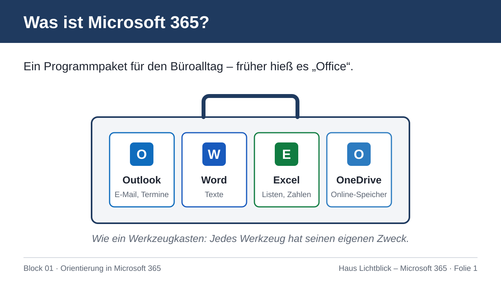
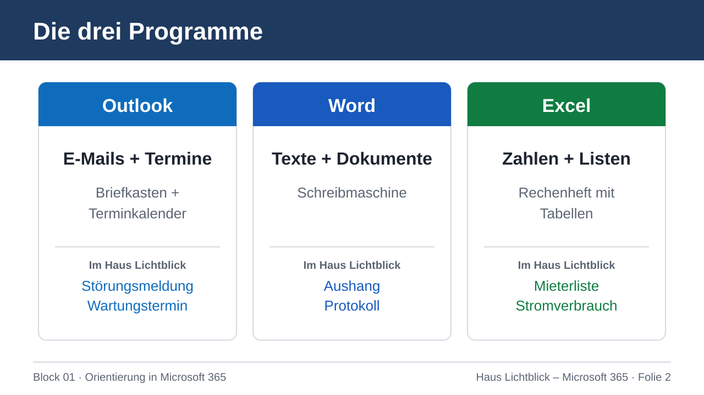
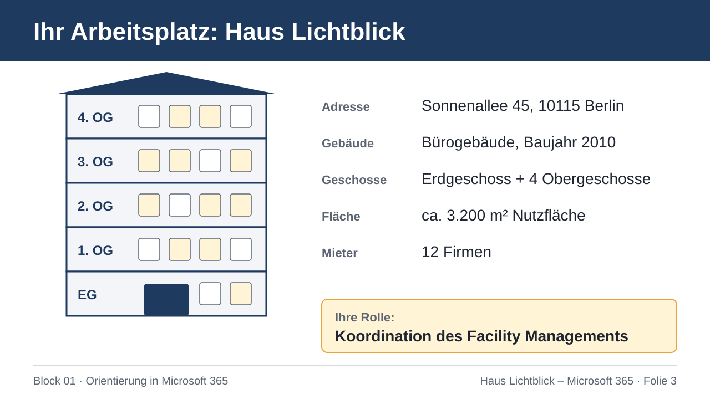
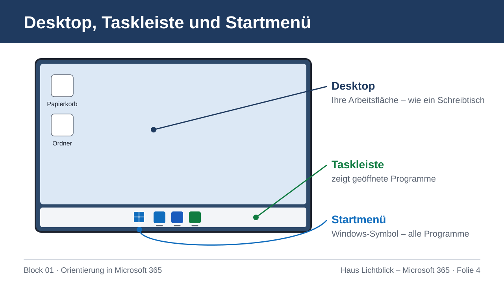
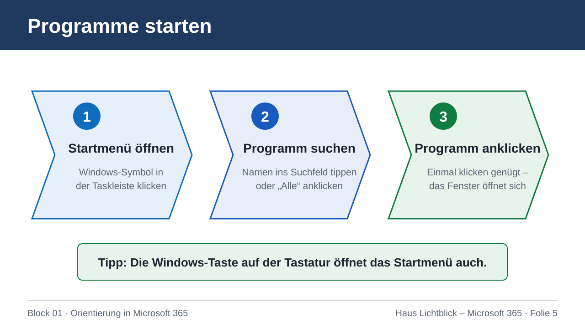
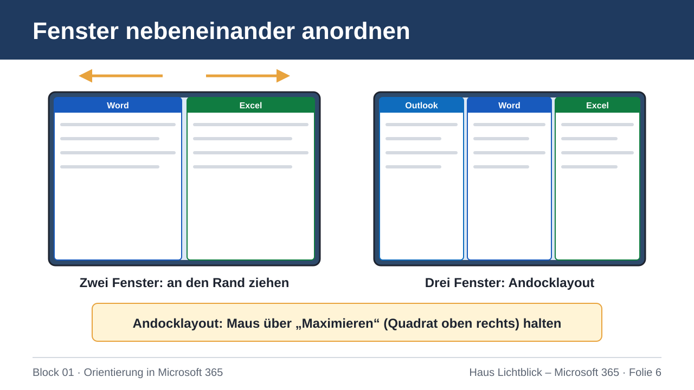

# Block 01 – Orientierung in Microsoft 365
{: .no_toc }

| | |
|---|---|
| **Programme** | Windows 11, Outlook, Word, Excel |
| **Voraussetzung** | keine |
| **Übungsblatt** | [Übungsblatt Block 01](Block-01-Uebungsblatt.md) |
| **Übungsdateien** | `Block-01-Willkommen.docx`, `Block-01-Mieterliste.xlsx` – siehe [unten](#uebungsdateien) |

Bevor es mit E-Mails, Texten und Tabellen losgeht, lernen Sie Ihr Werkzeug kennen: Was ist Microsoft 365, welche Programme gehören dazu, und wie bewegen Sie sich auf dem Bildschirm? Danach öffnen Sie Programme, wechseln zwischen ihnen und ordnen Fenster so an, dass Sie zwei oder drei Programme gleichzeitig im Blick haben.

{: .lernziele }
> - Die drei Programme Outlook, Word und Excel benennen und sagen, wofür Sie sie im Facility Management brauchen
> - Desktop, Taskleiste und Startmenü unterscheiden
> - Programme über das Startmenü öffnen und wieder schließen
> - Zwischen geöffneten Programmen wechseln
> - Fenster nebeneinander anordnen
> - Das Szenario „Haus Lichtblick“ in Grundzügen beschreiben

Inhalt dieser Seite

- TOC
{:toc}

## Was ist Microsoft 365?

Microsoft 365 ist ein **Programmpaket** für den Büroalltag. Stellen Sie es sich wie einen Werkzeugkasten vor: Jedes Werkzeug – jedes Programm – hat seinen eigenen Zweck. Dazu gehört ein Online-Speicher, **OneDrive**, in dem Sie Dateien ablegen können.

Microsoft 365 nutzen Sie mit einem **persönlichen Konto**. Ihre Firma oder Ihr Kursanbieter richtet es ein; meist melden Sie sich einmal an, danach starten die Programme ohne weitere Fragen.

{: .merke }
„Office“ ist der alte Name. Heute heißt das Paket **Microsoft 365**. Die App „Microsoft 365 Copilot“ (früher „Office“) ist nur ein Startportal – in diesem Kurs starten wir Outlook, Word und Excel direkt.

## Die drei Programme

| Programm | Vergleich | Wofür |
|---|---|---|
| **Outlook** | Briefkasten + Terminkalender | E-Mails schreiben und empfangen, Termine verwalten, Kontakte pflegen |
| **Word** | Schreibmaschine | Briefe, Aushänge, Protokolle und andere Textdokumente |
| **Excel** | Rechenheft mit Tabellen | Listen, Tabellen und Berechnungen mit Zahlen |

{: .praxis }
> - **Outlook:** Störungsmeldungen an den Hausmeister schicken, Wartungstermine mit der Heizungsfirma vereinbaren
> - **Word:** einen Aushang „Aufzug außer Betrieb“ gestalten, ein Begehungsprotokoll schreiben
> - **Excel:** die Mieterliste führen, das Reinigungsmaterial im Lager zählen, den Stromverbrauch auswerten

{: .merke }
Jedes Programm ist für seine Aufgabe gebaut. Excel kann zwar auch Text, aber Word macht es besser und einfacher – so wie Sie eine Schraube auch mit dem Hammer einschlagen *können*, der Schraubendreher aber das richtige Werkzeug ist.

## Ihr Arbeitsplatz: Haus Lichtblick

Alle Übungen in diesem Kurs spielen im **Haus Lichtblick**, einem Bürogebäude in Berlin. Sie übernehmen dort die **Koordination des Facility Managements**: Sie halten den Kontakt zu Hausmeister, Reinigung und Technik, zu den Firmen, die im Haus Räume gemietet haben, und zu den Dienstleistern, die Heizung, Aufzüge und Elektrik warten.

- Sonnenallee 45, 10115 Berlin, Baujahr 2010
- Erdgeschoss und vier Obergeschosse, rund 3.200 m² Nutzfläche
- 12 Firmen als Mieter
- Team: Thomas Weber (Hausmeister), Maria Schmidt (Reinigung), Jan Müller (Technik)

Alle Daten des Szenarios – Räume, Personen, Firmen, Listen – stehen in der [Referenzliste Haus Lichtblick]({{ "/referenz/" | relative_url }}). Namen, Firmen und Adressen sind erfunden.

## Desktop, Taskleiste und Startmenü

| Begriff | Was ist das? | Vergleich |
|---|---|---|
| **Desktop** | die Arbeitsfläche, die Sie nach dem Einschalten sehen, mit Symbolen für Programme und Dateien | Ihr Schreibtisch |
| **Taskleiste** | die Leiste am unteren Bildschirmrand; zeigt, welche Programme gerade geöffnet sind | Programmübersicht |
| **Startmenü** | öffnet sich mit dem Windows-Symbol in der Taskleiste; hier finden Sie alle installierten Programme | Inhaltsverzeichnis |

{: .merke }
Unter Windows 11 sitzt das Windows-Symbol **in der Mitte** der Taskleiste, nicht mehr links unten. Achten Sie auf das Symbol, nicht auf die Position – manche PCs sind so eingestellt, dass es weiter links steht.

{: .tipp }
Das Startmenü öffnet sich auch mit der **Windows-Taste** auf der Tastatur – links unten zwischen Strg und Alt.

## Programme starten

1. Klicken Sie auf das **Windows-Symbol** in der Taskleiste. Das Startmenü öffnet sich.
2. Tippen Sie den Programmnamen ins **Suchfeld**, zum Beispiel „Word“. Oder klicken Sie auf **„Alle“** und scrollen Sie durch die Liste.
3. Klicken Sie **einmal** auf den Programmnamen. Das Programm öffnet sich in einem eigenen Fenster.

{: .tipp }
Liegt auf dem Desktop eine Verknüpfung zum Programm, genügt ein Doppelklick darauf.

## Zwischen Programmen wechseln

1. Schauen Sie in die Taskleiste. Jedes geöffnete Programm hat dort ein Symbol, darunter einen kleinen Strich.
2. Klicken Sie auf das Symbol des Programms, zu dem Sie wechseln möchten.
3. Das Programm kommt in den Vordergrund.

{: .tipp }
Mit der Tastatur: **Alt** gedrückt halten und mehrmals **Tab** drücken. Windows zeigt alle offenen Fenster; beim Loslassen springt es zum ausgewählten.

## Fenster nebeneinander anordnen

Oft brauchen Sie zwei Programme gleichzeitig: links die Mieterliste in Excel, rechts den Brief in Word. Dafür gibt es drei Wege.

**Methode 1: von Hand ziehen**

1. Klicken Sie auf die **Titelleiste** des Fensters – die Leiste ganz oben mit dem Dateinamen – und halten Sie die Maustaste gedrückt.
2. Ziehen Sie das Fenster an die gewünschte Stelle.
3. Lassen Sie die Maustaste los.

**Methode 2: am Rand einrasten (schneller)**

1. Fassen Sie das Fenster an der Titelleiste.
2. Ziehen Sie es ganz an den **linken oder rechten Bildschirmrand**, bis ein Umriss erscheint.
3. Lassen Sie los. Das Fenster füllt die halbe Bildschirmbreite.
4. Windows zeigt die anderen offenen Fenster als kleine Bilder. Klicken Sie eins an – es füllt die andere Hälfte.

**Methode 3: Andocklayouts (Windows 11)**

1. Halten Sie die Maus kurz über die Schaltfläche **„Maximieren“** – das Quadrat oben rechts im Fenster.
2. Es erscheinen mehrere Layouts. Klicken Sie ein Feld an, zum Beispiel links in einem Layout mit drei Spalten.
3. Windows zeigt die übrigen offenen Programme. Klicken Sie sie nacheinander an, um die freien Felder zu füllen.

{: .tipp }
Ein Fenster ist „verschwunden“? Es ist nur verkleinert. Klicken Sie auf sein Symbol in der Taskleiste – es erscheint wieder.

## Programme schließen

1. Klicken Sie auf das **X** in der rechten oberen Ecke des Fensters.
2. Haben Sie etwas geändert, fragt das Programm, ob Sie speichern möchten. Für Übungen ohne Ergebnis wählen Sie **„Nicht speichern“**.

{: .achtung }
Das X ganz oben rechts schließt das **Programm** bzw. die Datei. Speichern Sie vorher, was Sie behalten möchten. Wie das geht, lernen Sie in Block 04.

## Jetzt üben

{: .uebung }
> Laden Sie das [Übungsblatt Block 01](Block-01-Uebungsblatt.md) und die beiden Übungsdateien herunter. Sie öffnen Outlook, Word und Excel, ordnen die Fenster an und suchen dabei Antworten in einer Begrüßungsmappe und in der Mieterliste des Hauses.

### Übungsdateien
{: #uebungsdateien }



## Häufige Fragen

**Warum brauche ich drei Programme? Kann nicht eins alles?**
Jedes Programm ist für einen bestimmten Zweck gebaut. Outlook für Post und Termine, Word für Texte, Excel für Zahlen. Mit dem passenden Werkzeug geht die Arbeit schneller.

**Was passiert, wenn ich etwas falsch mache?**
Am Computer geht fast nichts kaputt. **Strg+Z** macht den letzten Schritt rückgängig – in Word, Excel und Outlook.

**Ich finde das Programm im Startmenü nicht.**
Tippen Sie den Namen ins Suchfeld des Startmenüs: „Outlook“, „Word“ oder „Excel“. Das Programm erscheint sofort oben in der Liste.

## Wenn es hakt

| Problem | Lösung |
|---|---|
| Das Startmenü öffnet sich nicht. | Die Windows-Taste auf der Tastatur drücken (links unten zwischen Strg und Alt). |
| Das Windows-Symbol steht woanders als auf der Abbildung. | Nach dem Symbol suchen, nicht nach der Position. Wer es links haben möchte: „Einstellungen“ → „Personalisierung“ → „Taskleiste“ → „Verhalten der Taskleiste“ → „Taskleistenausrichtung“. |
| Ein Programm fragt nach einer Anmeldung. | Mit dem Konto anmelden, das Sie für Microsoft 365 bekommen haben. |
| Das Programm startet nicht oder fehlt. | Prüfen, ob Microsoft 365 installiert ist: „Einstellungen“ → „Apps“ → „Installierte Apps“, nach „Microsoft 365“ suchen. Fehlt es, die IT fragen. |
| Ein Fenster ist verschwunden. | Es ist verkleinert. In der Taskleiste auf das Programmsymbol klicken. |
| Die Maus ist ungewohnt. | Startmenü mit der Windows-Taste öffnen, Programmnamen tippen, Enter drücken. |

## Selbstcheck

Können Sie …

- [ ] Outlook, Word und Excel benennen und je eine Aufgabe aus dem Haus Lichtblick nennen?
- [ ] Desktop, Taskleiste und Startmenü auf Ihrem Bildschirm zeigen?
- [ ] alle drei Programme über das Startmenü öffnen?
- [ ] zwischen zwei Programmen wechseln – mit der Maus und mit Alt+Tab?
- [ ] zwei Fenster nebeneinander einrasten lassen?
- [ ] drei Fenster mit einem Andocklayout anordnen?
- [ ] alle Programme wieder schließen?

Wo Sie unsicher sind: den Abschnitt oben noch einmal lesen und die passende Aufgabe im Übungsblatt wiederholen.

## Für Coaching

{: .coaching }
> **Vorbereitung:** Microsoft 365 und das neue Outlook sind installiert, das Konto ist angemeldet. Vorab nachsehen, wo das Windows-Symbol in der Taskleiste steht. Die Übungsdateien liegen bereit oder werden gemeinsam heruntergeladen.
>
> **Tempo:** Langsam beginnen. Jede Mausbewegung kommentieren: „Ich gehe jetzt mit der Maus nach unten zum Windows-Symbol …“ Erst zeigen, dann selbst machen lassen.
>
> **Bildschirm teilen:** Nicht benötigte Fenster vorher schließen, Mauszeiger groß einstellen, die Maus ruhig bewegen.
>
> **Erfolg sichtbar machen:** Drei Programme öffnen und nebeneinander anordnen ist für Einsteigerinnen und Einsteiger schon viel – das ausdrücklich sagen.
>
> **Wer schneller ist:** in Word und Excel nach der Menüleiste oben (dem Menüband) schauen lassen – welche Registerkarten gibt es?

## Weiter

Mit dem ersten Programm geht es los: In [Block 02 – E-Mail-Grundlagen](Block-02.md) arbeiten Sie mit E-Mails in Outlook – zum Beispiel mit Störungsmeldungen an den Hausmeister.
