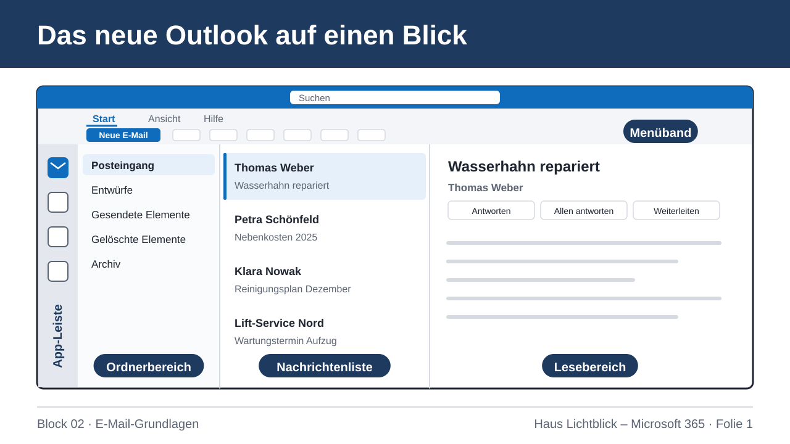
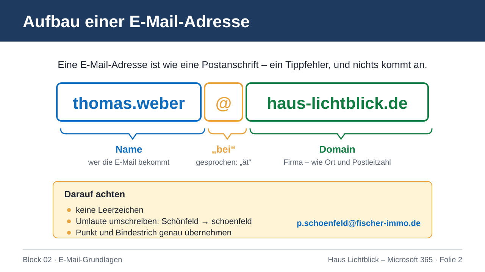
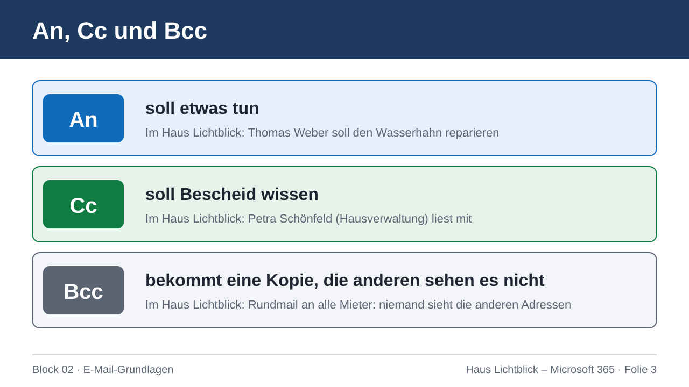
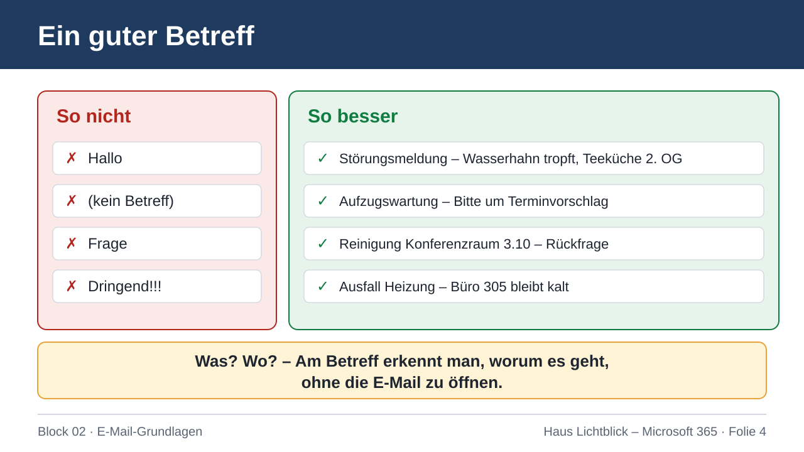
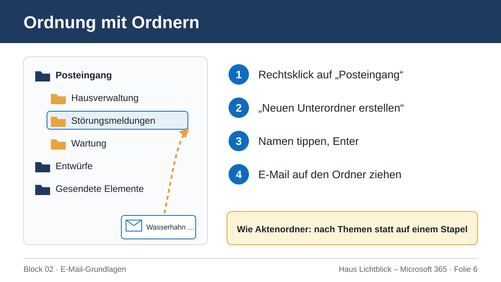

# Block 02 – E-Mail-Grundlagen
{: .no_toc }

| | |
|---|---|
| **Programme** | Outlook (neues Outlook für Windows) |
| **Voraussetzung** | Block 01; ein E-Mail-Konto in Outlook |
| **Übungsblatt** | [Übungsblatt Block 02](Block-02-Uebungsblatt.md) |
| **Übungsdateien** | `Block-02-Mailtexte.docx` – siehe [unten](#uebungsdateien) |

E-Mails sind im Facility Management das wichtigste Werkzeug: Störungen melden, Dienstleister beauftragen, die Hausverwaltung auf dem Laufenden halten. In diesem Block lernen Sie das neue Outlook kennen, schreiben Ihre ersten E-Mails, antworten, leiten weiter und halten Ihren Posteingang mit Ordnern in Ordnung.

{: .lernziele }
> - Die Bereiche des neuen Outlook benennen: App-Leiste, Ordnerbereich, Nachrichtenliste, Lesebereich, Menüband
> - Eine E-Mail-Adresse richtig lesen und schreiben
> - Eine neue E-Mail mit aussagekräftigem Betreff schreiben und senden
> - Den Unterschied zwischen An, Cc und Bcc erklären und anwenden
> - Auf eine E-Mail antworten und eine E-Mail mit Kommentar weiterleiten
> - Ordner im Posteingang anlegen und E-Mails dorthin verschieben

Inhalt dieser Seite

- TOC
{:toc}

## Das neue Outlook auf einen Blick

Outlook ist wie ein Schreibtisch: links die Schubladen (Ordner), in der Mitte der Stapel mit der Post, rechts der Brief, den Sie gerade lesen, oben das Werkzeug.

| Bereich | Wo? | Wofür |
|---|---|---|
| **App-Leiste** | schmale Leiste ganz links | zwischen E-Mail, Kalender und Personen wechseln |
| **Ordnerbereich** | daneben | Posteingang, Entwürfe, Gesendete Elemente, eigene Ordner |
| **Nachrichtenliste** | Mitte | alle E-Mails des gewählten Ordners, die neueste oben |
| **Lesebereich** | rechts | die angeklickte E-Mail mit „Antworten“ und „Weiterleiten“ |
| **Menüband** | oben | Befehle, zum Beispiel „Neue E-Mail“ auf der Registerkarte „Start“ |

{: .merke }
Es gibt zwei Outlook-Programme: das **neue Outlook** und das **klassische Outlook**. Dieser Kurs verwendet das neue. Sie erkennen es an der App-Leiste ganz links; Einstellungen finden Sie hinter dem Zahnrad oben rechts. Schreiben, Antworten, Weiterleiten und Ordner funktionieren in beiden gleich.

Die wichtigsten Ordner legt Outlook selbst an:

- **Posteingang** – hier kommt neue Post an.
- **Entwürfe** – E-Mails, die Sie angefangen, aber noch nicht gesendet haben.
- **Gesendete Elemente** – alles, was Sie verschickt haben.
- **Gelöschte Elemente** – der Papierkorb von Outlook.

## Die E-Mail-Adresse

Eine E-Mail-Adresse ist wie eine Postanschrift: Stimmt ein Zeichen nicht, kommt nichts an. Sie hat immer drei Teile.

| Teil | Beispiel | Bedeutung |
|---|---|---|
| Name | `thomas.weber` | wer die E-Mail bekommt |
| @ | `@` | „bei“, gesprochen „ät“ |
| Domain | `haus-lichtblick.de` | die Firma – wie Ort und Postleitzahl |

{: .achtung }
In E-Mail-Adressen gibt es **keine Leerzeichen**, und Umlaute werden meist umschrieben: Petra Schönfeld hat die Adresse `p.schoenfeld@fischer-immo.de`. Übernehmen Sie Punkte und Bindestriche genau.

{: .tipp }
Das @-Zeichen tippen Sie auf der deutschen Tastatur mit **AltGr+Q**.

## E-Mails an Sie selbst

{: .achtung }
Die Personen und Adressen im Haus Lichtblick sind **erfunden**. Senden Sie Übungs-E-Mails **nur an Ihre eigene Adresse**. Thomas Weber, Petra Schönfeld und alle anderen „spielen“ Sie selbst: Wo im Übungsblatt „an Thomas Weber“ steht, tragen Sie Ihre eigene Adresse ein.

So haben Sie nach dem Senden auch gleich Post im Posteingang, mit der Sie weiterüben können.

## Eine neue E-Mail schreiben

1. Klicken Sie in der App-Leiste auf das Symbol **E-Mail** (Briefumschlag).
2. Klicken Sie auf der Registerkarte **„Start“** auf **„Neue E-Mail“**. Rechts öffnet sich ein leeres Formular.
3. Tippen Sie ins Feld **„An“** die Adresse. Outlook schlägt beim Tippen bekannte Adressen vor – ein Klick übernimmt sie.
4. Klicken Sie in die Zeile **„Betreff hinzufügen“** und schreiben Sie, worum es geht.
5. Klicken Sie in das große Textfeld darunter und schreiben Sie Ihre Nachricht: Anrede, Text, Gruß.
6. Klicken Sie auf **„Senden“**.

{: .merke }
Eine E-Mail, die Sie noch nicht gesendet haben, speichert Outlook im Ordner **„Entwürfe“**. Dort können Sie sie später öffnen und fertig schreiben.

{: .tipp }
Text aus einer anderen Datei übernehmen: Text markieren, **Strg+C** (kopieren), ins Textfeld der E-Mail klicken, **Strg+V** (einfügen). So nutzen Sie die Mailtexte aus der Übungsdatei.

## An, Cc und Bcc

| Feld | Bedeutung | Im Haus Lichtblick |
|---|---|---|
| **An** | Diese Person soll etwas tun. | Thomas Weber soll den Wasserhahn reparieren. |
| **Cc** | Diese Person soll Bescheid wissen. | Petra Schönfeld von der Hausverwaltung liest mit. |
| **Bcc** | Diese Person bekommt eine Kopie – die anderen sehen es nicht. | Rundmail an alle Mieter: Niemand sieht die Adressen der anderen. |

Die Felder Cc und Bcc sind zuerst ausgeblendet:

1. Klicken Sie rechts neben dem Feld **„An“** auf **„Cc“** oder **„Bcc“**. Die Zeile erscheint.
2. Tippen Sie die Adresse ein.

{: .praxis }
Bei einer Rundmail an alle Mieter („Aufzugswartung am Montag“) setzen Sie die Mieter in **Bcc** und sich selbst in **An**. So bleibt die Liste der Mieter vertraulich, und niemand klickt aus Versehen auf „Allen antworten“.

## Ein guter Betreff

Stellen Sie sich vor, Sie bekommen 40 E-Mails am Tag. Woran erkennen Sie die wichtige? Am Betreff. Er sagt in wenigen Worten, **was** los ist und **wo**.

| So nicht | So besser |
|---|---|
| Hallo | Störungsmeldung – Wasserhahn tropft, Teeküche 2. OG |
| Frage | Reinigung Konferenzraum 3.10 – Rückfrage |
| (kein Betreff) | Aufzugswartung – Bitte um Terminvorschlag |

{: .merke }
Am Betreff soll man erkennen, worum es geht, **ohne die E-Mail zu öffnen**. Schreiben Sie zuerst das Thema, dann den Ort oder die Einzelheit.

## Antworten und weiterleiten

| Befehl | Geht an | Betreff beginnt mit |
|---|---|---|
| **Antworten** | nur die Person, die geschrieben hat | AW: |
| **Allen antworten** | die Person und alle aus „An“ und „Cc“ | AW: |
| **Weiterleiten** | eine neue Person, die Sie selbst eintragen | WG: |

**Antworten**

1. Klicken Sie die E-Mail in der Nachrichtenliste an.
2. Klicken Sie oben im Lesebereich auf **„Antworten“**. Die Adresse und der Betreff sind schon eingetragen.
3. Schreiben Sie Ihre Antwort über den alten Text und klicken Sie auf **„Senden“**.

**Weiterleiten mit Kommentar**

1. Klicken Sie die E-Mail an und dann oben im Lesebereich auf **„Weiterleiten“**.
2. Tragen Sie unter **„An“** die neue Person ein.
3. Schreiben Sie **über** den weitergeleiteten Text einen kurzen Kommentar: Was soll die Person damit tun?
4. Klicken Sie auf **„Senden“**.

{: .praxis }
Die Störungsmeldung über den tropfenden Wasserhahn leiten Sie an die Hausverwaltung weiter: „Hallo Frau Schönfeld, zur Info: Herr Weber kümmert sich darum. Falls ein Installateur nötig wird, melde ich mich.“

{: .achtung }
„Allen antworten“ nur, wenn wirklich alle Ihre Antwort brauchen. Ein „Danke!“ an 30 Personen nervt.

## Ordnung mit Ordnern

Ein voller Posteingang ist wie ein Stapel Papier auf dem Schreibtisch. Ordner sind die Aktenordner im Regal: eine für Störungen, eine für die Hausverwaltung, eine für die Wartung.

**Ordner anlegen**

1. Klicken Sie im Ordnerbereich mit der **rechten** Maustaste auf **„Posteingang“**.
2. Wählen Sie **„Neuen Unterordner erstellen“**.
3. Tippen Sie den Namen, zum Beispiel „Störungsmeldungen“, und drücken Sie **Enter**.

**E-Mail verschieben – mit der Maus**

1. Klicken Sie die E-Mail in der Nachrichtenliste an und **halten Sie die Maustaste gedrückt**.
2. Ziehen Sie die E-Mail auf den Ordner im Ordnerbereich.
3. Lassen Sie los, wenn der Ordner farbig hervorgehoben ist.

**E-Mail verschieben – mit dem Kontextmenü**

1. Klicken Sie mit der rechten Maustaste auf die E-Mail.
2. Wählen Sie **„Verschieben“** und dann den Ordner.

{: .tipp }
Ein Unterordner ist zugeklappt? Klicken Sie auf den kleinen Pfeil vor „Posteingang“ – dann sehen Sie alle Unterordner.

## Jetzt üben

{: .uebung }
> Laden Sie das [Übungsblatt Block 02](Block-02-Uebungsblatt.md) und die Übungsdatei herunter. Sie schreiben eine Störungsmeldung, wählen An, Cc und Bcc, verbessern Betreffzeilen, antworten, leiten weiter und räumen Ihren Posteingang mit Ordnern auf – alles mit Ihrer eigenen Adresse.

### Übungsdateien
{: #uebungsdateien }



## Häufige Fragen

**Wo landet eine E-Mail, die ich gesendet habe?**
Im Ordner „Gesendete Elemente“. Dort sehen Sie auch, an wen sie ging und wann.

**Kann ich eine gesendete E-Mail zurückholen?**
Verlassen Sie sich nicht darauf. Was gesendet ist, ist meistens beim Empfänger. Lesen Sie Empfänger und Betreff deshalb vor dem Senden noch einmal.

**Was ist der Unterschied zwischen Antworten und Weiterleiten?**
Antworten geht zurück an die Person, die geschrieben hat. Weiterleiten schickt die E-Mail an jemand Neues.

**Ich habe aus Versehen eine E-Mail gelöscht.**
Sie liegt im Ordner „Gelöschte Elemente“. Ziehen Sie sie zurück in den Posteingang.

## Wenn es hakt

| Problem | Lösung |
|---|---|
| Outlook zeigt keinen Posteingang. | In der App-Leiste auf das Briefumschlag-Symbol (E-Mail) klicken, dann im Ordnerbereich auf „Posteingang“. |
| Das klassische statt des neuen Outlook ist offen. | Oben rechts den Schalter „Neues Outlook“ einschalten oder das neue Outlook über das Startmenü starten. |
| Das Menüband zeigt nur eine schmale Zeile. | Am rechten Ende des Menübands auf den kleinen Pfeil klicken und „Klassisches Menüband“ wählen. |
| Die E-Mail ist nicht angekommen. | Im Ordner „Gesendete Elemente“ nachsehen, ob sie verschickt wurde, und die Adresse auf Tippfehler prüfen. Etwas warten. |
| „Neuen Unterordner erstellen“ fehlt. | Mit der rechten Maustaste direkt auf „Posteingang“ klicken, nicht auf eine E-Mail. |
| Das Ziehen mit der Maus klappt nicht. | Maustaste wirklich gedrückt halten. Oder: Rechtsklick auf die E-Mail → „Verschieben“ → Ordner wählen. |
| Die Zeile „Cc“ oder „Bcc“ fehlt. | Rechts neben dem Feld „An“ auf „Cc“ oder „Bcc“ klicken. |

## Selbstcheck

Können Sie …

- [ ] die fünf Bereiche des neuen Outlook auf Ihrem Bildschirm zeigen?
- [ ] eine E-Mail-Adresse in ihre drei Teile zerlegen?
- [ ] eine neue E-Mail mit gutem Betreff schreiben und senden?
- [ ] sagen, wann Sie An, Cc und Bcc verwenden?
- [ ] auf eine E-Mail antworten?
- [ ] eine E-Mail mit einem Kommentar weiterleiten?
- [ ] einen Ordner im Posteingang anlegen und E-Mails hineinschieben?

Wo Sie unsicher sind: den Abschnitt oben noch einmal lesen und die passende Aufgabe im Übungsblatt wiederholen.

## Für Coaching

{: .coaching }
> **Vorbereitung:** Das neue Outlook ist gestartet und zeigt den Posteingang, das Konto ist angemeldet. Klären, welche eigene Adresse die lernende Person für die Übungen nutzt. Private E-Mails vor dem Teilen des Bildschirms schließen.
>
> **Tempo:** Viele Einsteigerinnen und Einsteiger tippen langsam. Für die erste Störungsmeldung viel Zeit lassen; die Mailtexte aus der Übungsdatei dürfen kopiert werden.
>
> **Bildschirm teilen:** Ziehen mit der Maus („Drag & Drop“) in Zeitlupe zeigen und dabei sprechen: „Klicken, Maustaste gedrückt halten, zum Ordner ziehen, loslassen.“
>
> **Erfolg sichtbar machen:** Die erste eigene E-Mail im Posteingang ist ein kleiner Meilenstein – gemeinsam ansehen. Den Betreff gemeinsam bewerten: Würde man ihn unter 40 E-Mails finden?
>
> **An, Cc, Bcc:** nur kurz erklären; Bcc ist im Alltag selten. Wer das klassische Outlook vom Arbeitsplatz kennt: E-Mail, Kalender und Personen stehen jetzt in der App-Leiste links, die Einstellungen hinter dem Zahnrad.
>
> **Wer schneller ist:** einen dritten Ordner „Wartung“ anlegen; eine E-Mail mit „Allen antworten“ beantworten und vergleichen, wer die Antwort bekommt.

## Weiter

Nach den E-Mails kommt der Kalender: In [Block 03 – Kalender und Termine](Block-03.md) planen Sie Wartungstermine und Besprechungen in Outlook.
