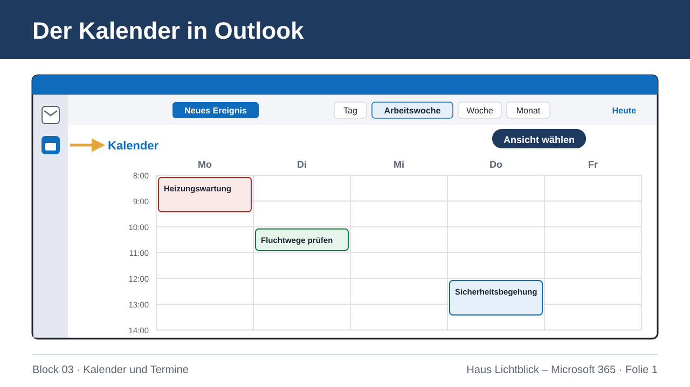
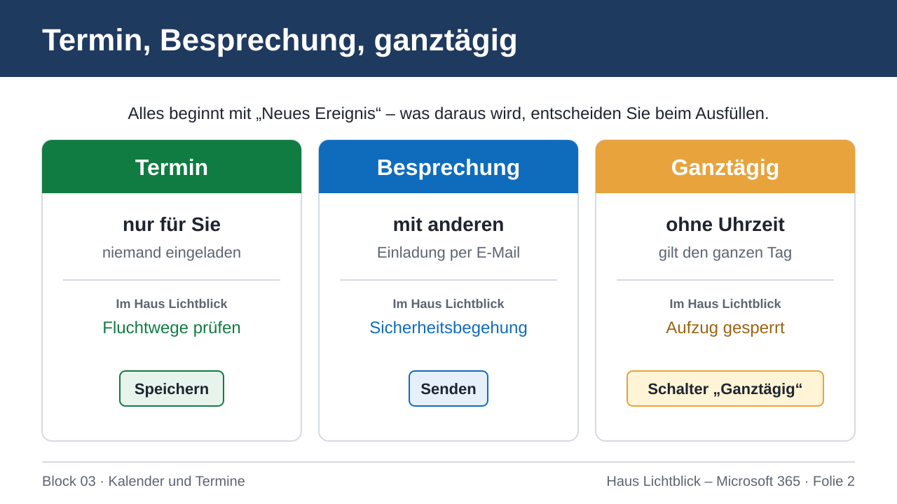
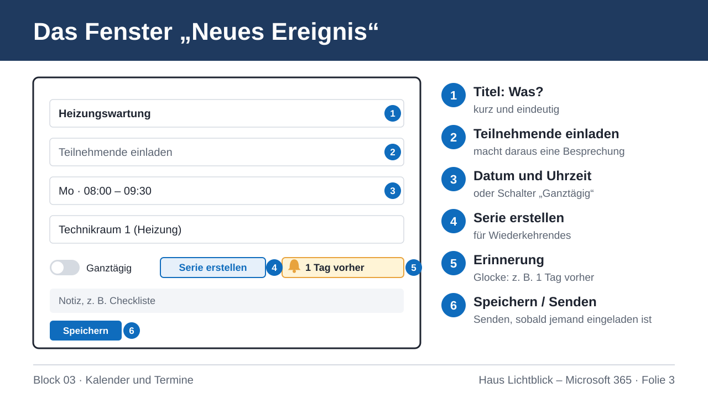
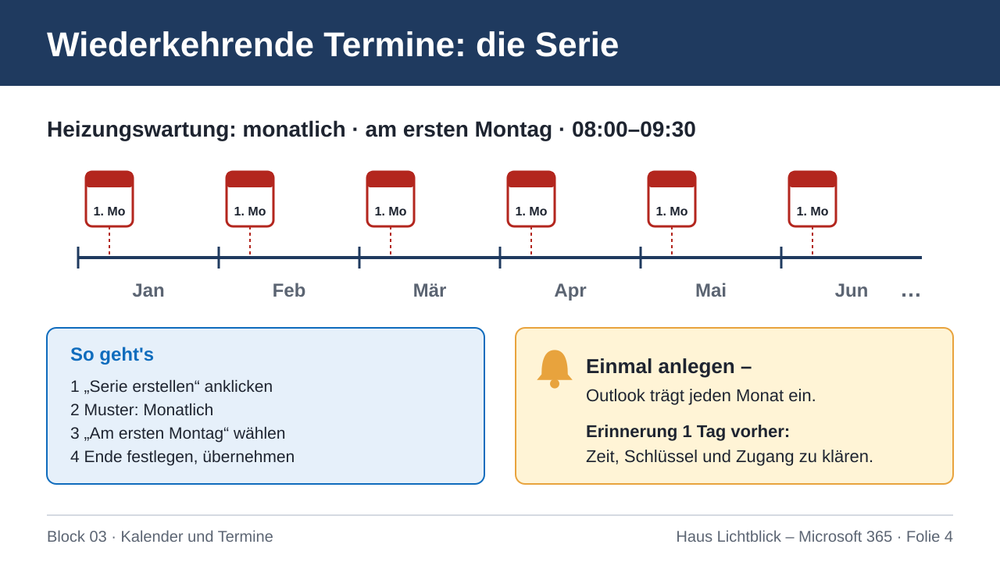
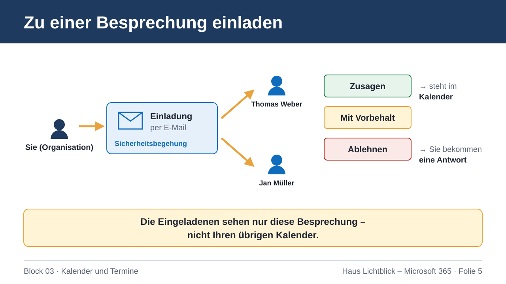

# Block 03 – Kalender und Termine
{: .no_toc }

| | |
|---|---|
| **Programme** | Outlook (neues Outlook für Windows) |
| **Voraussetzung** | Block 02 |
| **Übungsblatt** | [Übungsblatt Block 03](Block-03-Uebungsblatt.md) |
| **Übungsdateien** | `Block-03-Terminplan.docx` – siehe [unten](#uebungsdateien) |

Im Facility Management hängt vieles an Terminen: Die Heizung wird jeden Monat gewartet, die Aufzüge jedes Quartal, die Feuerlöscher jedes Jahr. Dazu kommen Begehungen und Besprechungen. In diesem Block machen Sie den Outlook-Kalender zu Ihrem Planungswerkzeug – mit Erinnerungen, damit nichts untergeht.

{: .lernziele }
> - Zwischen E-Mail und Kalender wechseln und die Ansichten Tag, Woche und Monat nutzen
> - Termin, Besprechung und ganztägiges Ereignis unterscheiden
> - Einen Termin mit Erinnerung anlegen
> - Einen wiederkehrenden Termin (Serie) anlegen
> - Andere Personen zu einer Besprechung einladen
> - Termine verschieben, ändern und löschen

Inhalt dieser Seite

- TOC
{:toc}

## Der Kalender in Outlook

Der Kalender gehört zu Outlook. Sie wechseln über die **App-Leiste** ganz links:

1. Klicken Sie auf das **Kalendersymbol** – es sieht aus wie ein kleines Kalenderblatt.
2. Zurück zu den E-Mails geht es mit dem **Briefumschlag** darüber.

Oben wählen Sie, wie viel Sie sehen:

| Ansicht | Zeigt | Gut für |
|---|---|---|
| **Tag** | einen Tag mit Uhrzeiten | einen vollen Tag planen |
| **Arbeitswoche** | Montag bis Freitag | den Überblick über die Woche |
| **Woche** | sieben Tage | Termine am Wochenende |
| **Monat** | den ganzen Monat | Wartungen und Fristen auf lange Sicht |

{: .tipp }
Mit **„Heute“** springen Sie aus jeder Ansicht zurück zum aktuellen Tag. Mit den Pfeilen daneben blättern Sie vor und zurück.

## Termin, Besprechung oder ganztägig?

Im neuen Outlook beginnt jeder Eintrag mit **„Neues Ereignis“**. Was daraus wird, entscheiden Sie beim Ausfüllen:

| Art | Wann? | Woran erkennen Sie es? | Im Haus Lichtblick |
|---|---|---|---|
| **Termin** | nur für Sie | niemand eingeladen, Schaltfläche „Speichern“ | Fluchtwege prüfen |
| **Besprechung** | mit anderen; geht als Einladung per E-Mail hinaus | Personen eingeladen, Schaltfläche „Senden“ | Sicherheitsbegehung mit Hausmeister und Technik |
| **Ganztägiges Ereignis** | ohne feste Uhrzeit, gilt den ganzen Tag | Schalter „Ganztägig“ eingeschaltet | Aufzug gesperrt – Wartung |

{: .merke }
Wer das klassische Outlook kennt, sucht vergeblich nach getrennten Schaltflächen „Neuer Termin“ und „Neue Besprechung“. Im neuen Outlook gibt es nur **„Neues Ereignis“**. Sobald Sie jemanden einladen, wird aus „Speichern“ **„Senden“** – daran sehen Sie, dass aus dem Termin eine Besprechung geworden ist.

## Einen Termin anlegen

1. Wechseln Sie zum Kalender.
2. Klicken Sie auf **„Neues Ereignis“**. Ein Fenster öffnet sich.
3. Tippen Sie oben den **Titel** ein: kurz und eindeutig, zum Beispiel „Fluchtwege prüfen“.
4. Wählen Sie **Datum**, **Beginn** und **Ende**. Ein Klick auf das Datum öffnet einen kleinen Kalender.
5. Tragen Sie bei Bedarf einen **Ort** ein, zum Beispiel „Eingangshalle“.
6. Stellen Sie die **Erinnerung** ein: Klicken Sie auf das Feld mit der Glocke und wählen Sie eine Zeit.
7. Klicken Sie auf **„Speichern“**. Der Termin steht im Kalender.

**Ganztägiges Ereignis:** Schalten Sie in Schritt 4 den Schalter **„Ganztägig“** ein. Die Uhrzeiten verschwinden, das Ereignis steht oben über dem Tag.

**Wie lange vorher erinnern?**

- Kurze Termine im Haus: **15 Minuten vorher** (Standard)
- Besprechungen außer Haus: **1 Stunde vorher**
- Wartungen mit Dienstleistern: **1 Tag vorher** – Zeit, um Schlüssel, Zugang und Mieter zu informieren

## Wiederkehrende Termine: die Serie

Die Heizung im Haus Lichtblick wird **jeden ersten Montag im Monat** von 08:00 bis 09:30 Uhr gewartet. Statt zwölf Termine einzutragen, legen Sie eine **Serie** an – einmal Arbeit, Outlook trägt den Rest ein.

1. Öffnen Sie **„Neues Ereignis“** und tragen Sie Titel, Datum, Beginn und Ende ein. Das Datum ist der erste Termin der Serie.
2. Klicken Sie im Ereignisfenster auf **„Serie erstellen“** (in manchen Versionen „Wiederholen“).
3. Wählen Sie das Muster: **Monatlich**.
4. Wählen Sie **„Am ersten Montag“**.
5. Legen Sie ein **Ende** fest oder lassen Sie die Serie ohne Ende laufen. Übernehmen Sie die Einstellung.
6. Stellen Sie die Erinnerung auf **1 Tag** und klicken Sie auf **„Speichern“**.

{: .praxis }
> Wiederkehrende Termine im Haus Lichtblick:
> - **Heizung:** monatlich, jeden ersten Montag, 08:00–09:30 Uhr
> - **Aufzüge:** quartalsweise – also alle drei Monate
> - **Feuerlöscher:** jährlich

**Eine Serie ändern oder löschen:** Wenn Sie einen Termin der Serie öffnen, verschieben oder löschen, fragt Outlook, ob das nur für **dieses Ereignis** oder für die **ganze Serie** gelten soll. Fällt nur ein Termin aus, ändern Sie nur diesen.

{: .achtung }
Löschen Sie bei einer Serie nicht versehentlich alle Termine. Lesen Sie die Frage von Outlook genau, bevor Sie klicken.

## Zu einer Besprechung einladen

1. Klicken Sie auf **„Neues Ereignis“**.
2. Tragen Sie im Feld **„Teilnehmende einladen“** die E-Mail-Adressen ein. Die Schaltfläche heißt jetzt **„Senden“**.
3. Füllen Sie Titel, Datum, Uhrzeit und Ort aus.
4. Schreiben Sie bei Bedarf eine kurze Nachricht in das große Textfeld, etwa die Tagesordnung.
5. Klicken Sie auf **„Senden“**.

Die Eingeladenen bekommen eine E-Mail mit den Schaltflächen **„Zusagen“**, **„Mit Vorbehalt“** und **„Ablehnen“**. Wer zusagt, hat die Besprechung im eigenen Kalender. Sie selbst bekommen die Antworten als E-Mail und sehen im Ereignis, wer zugesagt hat.

{: .achtung }
Wie in Block 02 gilt: Die Personen im Haus Lichtblick sind erfunden. Laden Sie in den Übungen **nur eigene Adressen** ein. Haben Sie nur eine Adresse, füllen Sie das Feld aus, sehen sich die Schaltfläche „Senden“ an und schließen das Fenster, ohne zu senden.

## Termine ändern und Farben vergeben

**Verschieben:** Ziehen Sie den Termin im Kalender mit gedrückter Maustaste auf eine andere Uhrzeit oder einen anderen Tag.

**Ändern:** Doppelklick auf den Termin, Angaben ändern, „Speichern“ – bei einer Besprechung „Senden“, damit alle die Änderung bekommen.

**Löschen:** Termin anklicken, **Entf** drücken. Bei einer Besprechung bietet Outlook an, den Eingeladenen eine Absage zu schicken.

**Farben:** Klicken Sie mit der rechten Maustaste auf den Termin und wählen Sie **„Kategorisieren“**. Zum Beispiel Wartung = Rot, Besprechungen = Blau, Kontrollgänge = Grün. So behalten Sie in einem vollen Kalender den Überblick.

## Jetzt üben

{: .uebung }
> Laden Sie das [Übungsblatt Block 03](Block-03-Uebungsblatt.md) und die Übungsdatei herunter. Die Hausverwaltung hat Ihnen einen Terminplan geschickt: Sie tragen einen Kontrollgang, eine Aufzugssperre, die monatliche Heizungswartung und eine Sicherheitsbegehung in Ihren Kalender ein – und räumen am Ende wieder auf.

### Übungsdateien
{: #uebungsdateien }



## Häufige Fragen

**Sehen andere meinen ganzen Kalender, wenn ich sie einlade?**
Nein. Die Eingeladenen sehen nur diese eine Besprechung. Ihr übriger Kalender bleibt privat, solange Sie ihn nicht ausdrücklich freigeben.

**Was passiert, wenn jemand ablehnt?**
Sie bekommen eine E-Mail mit der Absage. Die Besprechung bleibt in Ihrem Kalender; im Ereignis sehen Sie, wer zu- und wer abgesagt hat.

**Kann ich eine Serie beenden?**
Ja. Öffnen Sie einen Termin der Serie, wählen Sie die ganze Serie und legen Sie unter „Serie erstellen“ ein Enddatum fest.

**Kann ich Räume einladen?**
Wenn Ihre Firma Raumpostfächer eingerichtet hat, laden Sie den Raum wie eine Person ein – er ist dann gebucht. Im Haus Lichtblick gibt es das nicht; Sie tragen den Raum als Ort ein.

## Wenn es hakt

| Problem | Lösung |
|---|---|
| Der Kalender ist nicht zu sehen. | In der App-Leiste links auf das Kalendersymbol klicken. |
| „Serie erstellen“ ist nicht zu finden. | Das Ereignis über „Neues Ereignis“ öffnen, nicht direkt in den Kalender tippen. Eine Einladung, die jemand anderes verschickt hat, können Sie nicht als Serie ändern. |
| Die Einladung wurde nicht verschickt. | Es war niemand eingeladen, deshalb nur „Speichern“. Ereignis öffnen, Personen eintragen, „Senden“. |
| Die Uhrzeiten stimmen nicht. | Zeitzone prüfen: Einstellungen (Zahnrad oben rechts) → „Kalender“. Richtig ist (UTC+01:00) Amsterdam, Berlin … |
| Die Erinnerung kommt nicht. | Outlook muss geöffnet sein. Im Ereignis prüfen, ob eine Erinnerung eingestellt ist. |
| Ich habe die ganze Serie gelöscht. | Die Serie neu anlegen – die Angaben stehen im Terminplan. |

## Selbstcheck

Können Sie …

- [ ] zwischen E-Mail und Kalender wechseln und die Ansicht ändern?
- [ ] sagen, wann ein Eintrag Termin, Besprechung oder ganztägiges Ereignis ist?
- [ ] einen Termin mit Erinnerung anlegen?
- [ ] die Heizungswartung als Serie am ersten Montag jedes Monats anlegen?
- [ ] jemanden zu einer Besprechung einladen?
- [ ] einen Termin verschieben und eine Serie wieder löschen?

Wo Sie unsicher sind: den Abschnitt oben noch einmal lesen und die passende Aufgabe im Übungsblatt wiederholen.

## Für Coaching

{: .coaching }
> **Vorbereitung:** Outlook im Kalender öffnen, Ansicht „Arbeitswoche“. Klären, ob die lernende Person eine zweite eigene Adresse für die Besprechung hat. Der Kalender sollte für die Übung nicht zu voll sein – sonst einen ruhigen Monat wählen.
>
> **Tempo:** Die Serie ist für Einsteigerinnen und Einsteiger abstrakt. Langsam zeigen und dabei sagen, was Outlook jetzt tut: „Ich lege einen Termin an, und Outlook kopiert ihn auf jeden ersten Montag.“ Danach gemeinsam im Monatsblick nachsehen.
>
> **Bildschirm teilen:** Wochenansicht nutzen, sie ist am übersichtlichsten. Den Wechsel von „Speichern“ zu „Senden“ zeigen, sobald jemand eingetragen wird.
>
> **Erfolg sichtbar machen:** Im Monatsblick zeigen, wie die Heizungswartung in jedem Monat steht – eine Eingabe, zwölf Termine.
>
> **Aufräumen nicht vergessen:** Am Ende die Übungstermine löschen, bei der Serie „ganze Serie“ – sonst erinnert Outlook monatelang an die Heizungswartung.
>
> **Wer schneller ist:** Feuerlöscherprüfung als jährliche Serie anlegen; Termine mit „Kategorisieren“ farbig markieren.

## Weiter

Nach Outlook kommt Word: In [Block 04 – Texte erstellen, formatieren und speichern](Block-04.md) schreiben Sie einen ersten Aushang für das Haus Lichtblick.
