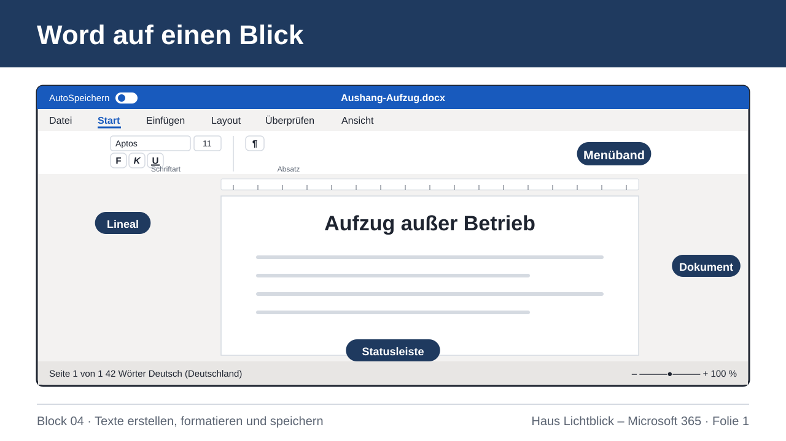
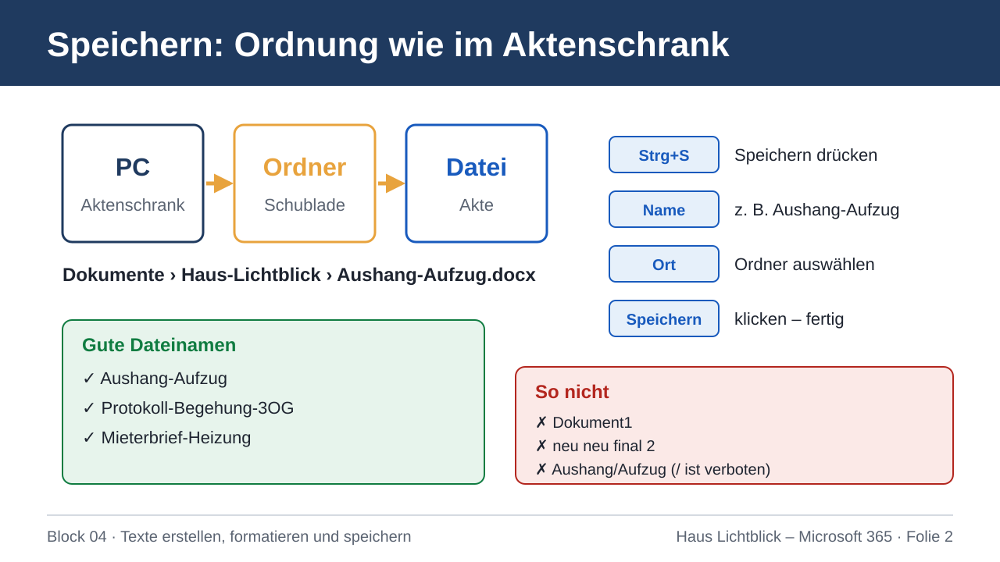
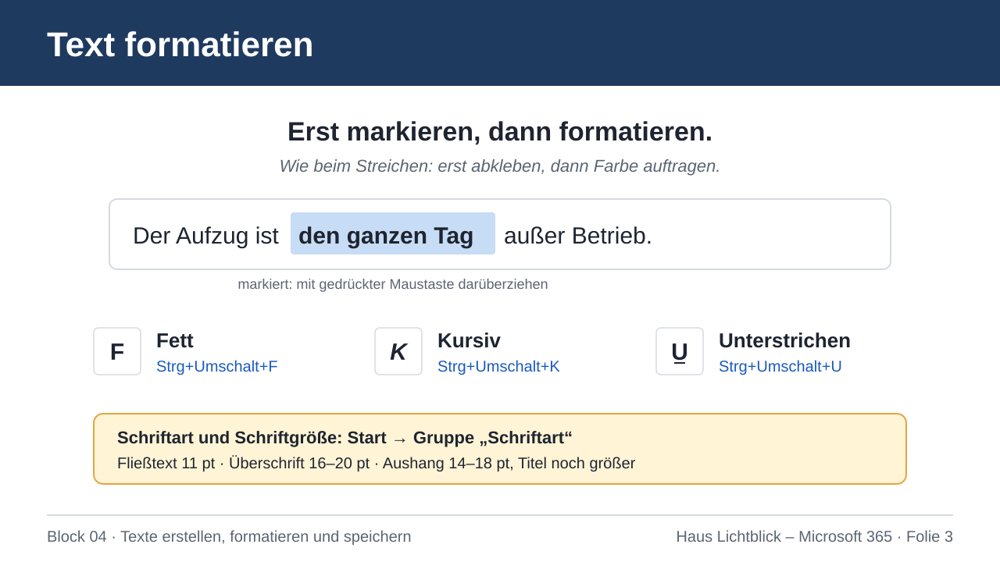
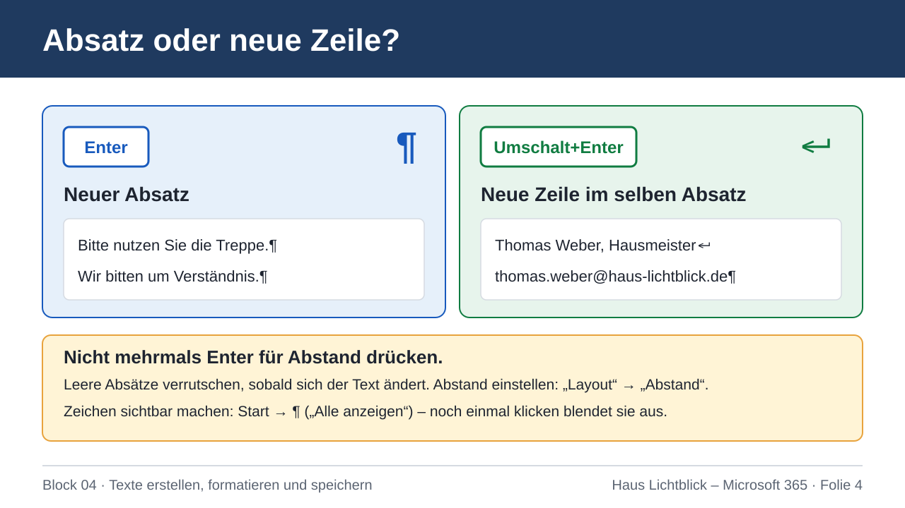
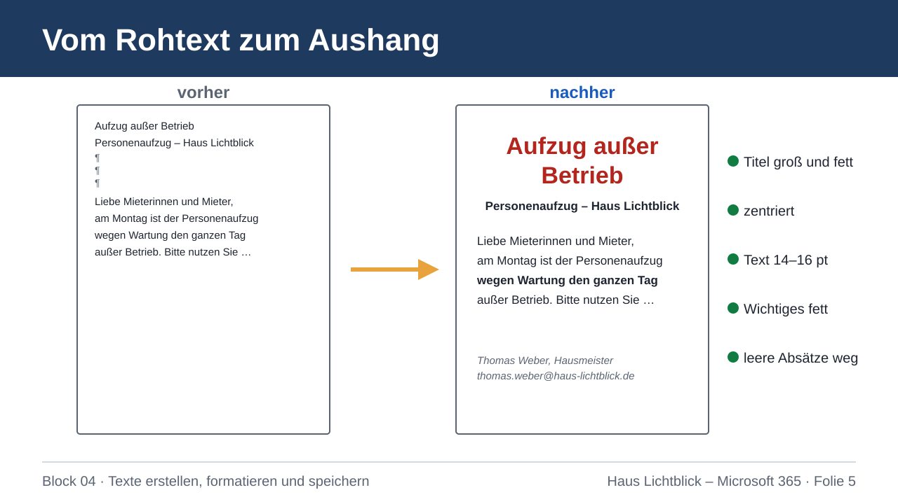

# Block 04 – Texte erstellen, formatieren und speichern
{: .no_toc }

| | |
|---|---|
| **Programme** | Word |
| **Voraussetzung** | Block 01 |
| **Übungsblatt** | [Übungsblatt Block 04](Block-04-Uebungsblatt.md) |
| **Übungsdateien** | `Block-04-Aushang.docx`, Lösung `Block-04-Loesung-Aushang.docx` – siehe [unten](#uebungsdateien) |

Jetzt kommt Word, das Programm für Texte. Im Facility Management schreiben Sie damit Aushänge, Protokolle und Briefe an die Mieter. In diesem Block legen Sie ein Dokument an, speichern es so, dass Sie es wiederfinden, und machen aus einem schlichten Rohtext einen gut lesbaren Aushang: „Aufzug außer Betrieb“.

{: .lernziele }
> - Die Word-Oberfläche benennen: Menüband, Lineal, Dokument, Statusleiste
> - Ein neues Dokument erstellen und unter einem sinnvollen Namen in einem eigenen Ordner speichern
> - Text markieren und formatieren: Schriftart, Schriftgröße, fett, kursiv, unterstrichen
> - Absatz und Zeilenumbruch unterscheiden und Formatierungszeichen einblenden
> - Fehler mit Strg+Z rückgängig machen
> - Einen Aushang drucken

Inhalt dieser Seite

- TOC
{:toc}

## Word auf einen Blick

| Bereich | Wo? | Wofür |
|---|---|---|
| **Titelleiste** | ganz oben | Dateiname, Schalter „AutoSpeichern“ |
| **Registerkarten** | darunter: Datei, Start, Einfügen, Layout … | ordnen die Befehle nach Themen |
| **Menüband** | unter den Registerkarten | die Befehle der gewählten Registerkarte, in Gruppen wie „Schriftart“ und „Absatz“ |
| **Lineal** | über dem Dokument | zeigt Ränder und Einzüge |
| **Dokument** | Mitte | die Seite, auf der Sie schreiben; der blinkende Strich ist die Schreibmarke |
| **Statusleiste** | ganz unten | Seitenzahl, Anzahl der Wörter, Sprache, Zoom |

Das Menüband ist wie ein Werkzeugkasten mit Schubladen: Jede Registerkarte ist eine Schublade. Fürs Schreiben und Formatieren brauchen Sie fast nur die Registerkarte **„Start“**.

{: .tipp }
Kein Lineal zu sehen? Registerkarte **„Ansicht“** → Häkchen bei **„Lineal“** setzen.

## Ein neues Dokument

1. Starten Sie Word über das Startmenü.
2. Klicken Sie auf **„Leeres Dokument“**. Eine leere Seite öffnet sich, die Schreibmarke blinkt oben links.
3. Schreiben Sie einfach los. Am Zeilenende brauchen Sie kein Enter – Word bricht selbst um.

{: .tipp }
Word unterstreicht unbekannte Wörter mit einer **roten Wellenlinie**. Klicken Sie mit der rechten Maustaste darauf: Oben stehen Vorschläge, ein Klick übernimmt den richtigen.

## Speichern

Ein Dokument, das Sie nicht speichern, ist weg, sobald Sie Word schließen. Speichern heißt: Sie legen das Dokument als **Datei** in einem **Ordner** ab – wie eine Akte in einer Schublade des Aktenschranks.

**Zum ersten Mal speichern**

1. Drücken Sie **Strg+S**. Word fragt nach Namen und Speicherort.
2. Tippen Sie einen **Dateinamen**, der sagt, was drin ist: `Aushang-Aufzug` statt `Dokument1`.
3. Wählen Sie den Ort. Klicken Sie auf **„Weitere Speicheroptionen“** und dann auf **„Durchsuchen“**. Ein Fenster mit Ihren Ordnern öffnet sich.
4. Wählen Sie links **„Dokumente“**. Für den Kurs legen Sie dort einmal mit **„Neuer Ordner“** einen Ordner `Haus-Lichtblick` an und öffnen ihn mit Doppelklick.
5. Klicken Sie auf **„Speichern“**. Der Name steht jetzt oben in der Titelleiste.

**Weiter speichern:** Ab jetzt genügt **Strg+S** – ohne Nachfrage. Speichern Sie früh und oft.

{: .merke }
Word-Dateien enden auf **.docx**. Die Endung hängt Word selbst an – Sie tippen nur den Namen. Diese Zeichen sind in Dateinamen verboten: `/ \ : * ? " < > |`

**AutoSpeichern:** Liegt eine Datei in **OneDrive**, speichert Word jede Änderung automatisch; der Schalter oben links steht dann auf „Ein“. Bei Dateien auf dem eigenen PC ist AutoSpeichern aus – dann gilt: Strg+S. Mit AutoSpeichern heißt „Speichern unter“ im Menü „Datei“ **„Kopie speichern“**: Sie arbeiten danach in der Kopie weiter.

**Eine Datei wieder öffnen:** In Word **„Datei“** → **„Öffnen“**. Unter **„Zuletzt verwendet“** stehen Ihre letzten Dateien – ein Klick öffnet sie.

## Text formatieren

Die wichtigste Regel: **Erst markieren, dann formatieren.** Wie beim Streichen: erst abkleben, dann Farbe auftragen.

**Markieren**

- **Mit der Maus:** Vor das erste Zeichen klicken, Maustaste gedrückt halten, bis hinter das letzte Zeichen ziehen, loslassen. Der Text ist farbig hinterlegt.
- **Ein Wort:** Doppelklick auf das Wort.
- **Mit der Tastatur:** **Umschalt** gedrückt halten und mit den Pfeiltasten ziehen.

**Formatieren** – auf der Registerkarte **„Start“**, Gruppe **„Schriftart“**:

| Was | Schaltfläche | Tastenkürzel |
|---|---|---|
| Fett | **F** | Strg+Umschalt+F |
| Kursiv | *K* | Strg+Umschalt+K |
| Unterstrichen | U | Strg+Umschalt+U |
| Schriftart | Feld mit „Aptos“ | – |
| Schriftgröße | Feld mit „11“ | – |

Ein zweiter Klick auf F, K oder U nimmt die Formatierung wieder weg.

**Wie groß?**

- Fließtext in Briefen und Protokollen: **11 pt**
- Überschriften: **16–20 pt**
- Aushänge, die man im Vorbeigehen liest: Text **14–18 pt**, der Titel noch größer

**Ausrichten** – Gruppe **„Absatz“**: Linksbündig ist Standard. Für den Titel eines Aushangs passt **„Zentriert“** (Strg+E).

{: .achtung }
Nichts passiert, wenn Sie auf **F** klicken? Dann war kein Text markiert. Markieren Sie zuerst, dann klicken Sie.

## Absatz oder neue Zeile?

| Taste | Ergebnis | Zeichen | Wann? |
|---|---|---|---|
| **Enter** | neuer Absatz | ¶ | ein neuer Gedanke, eine neue Überschrift |
| **Umschalt+Enter** | neue Zeile im selben Absatz | ↵ | Zeilen, die zusammengehören: Name und E-Mail-Adresse |

**Formatierungszeichen einblenden:** Klicken Sie auf der Registerkarte **„Start“** in der Gruppe **„Absatz“** auf **¶** („Alle anzeigen“). Jetzt sehen Sie, wo Enter (¶), Umschalt+Enter (↵) und Leerzeichen (·) gedrückt wurden. Noch ein Klick blendet die Zeichen wieder aus – gedruckt werden sie nie.

{: .merke }
Drücken Sie **nicht mehrmals Enter**, um Abstand zu schaffen. Leere Absätze verrutschen, sobald Sie etwas ändern. Abstand stellen Sie auf der Registerkarte **„Layout“** bei **„Abstand“** mit den Feldern „Vor“ und „Nach“ ein.

## Rückgängig machen

**Strg+Z** ist Ihr Sicherheitsnetz: Es macht den letzten Schritt rückgängig. Mehrmals drücken geht mehrere Schritte zurück. **Strg+Y** stellt einen rückgängig gemachten Schritt wieder her.

Die gleichen Befehle finden Sie als gebogene Pfeile auf der Registerkarte „Start“ ganz links.

{: .praxis }
Aus Versehen den ganzen Aushang gelöscht? Nicht speichern, sondern sofort **Strg+Z**. Der Text ist wieder da.

## Vom Rohtext zum Aushang

Die Übungsdatei enthält den Text des Aushangs „Aufzug außer Betrieb“ – ohne Formatierung und mit überflüssigen leeren Absätzen. So wird daraus ein Aushang:

1. Formatierungszeichen einblenden (¶) und leere Absätze löschen.
2. Titel groß, fett und zentriert.
3. Text auf 14–16 pt vergrößern.
4. Das Wichtigste fett: **wann** der Aufzug nicht fährt.
5. Kontakt mit Umschalt+Enter zusammenfassen und kursiv setzen.
6. Speichern, ansehen, drucken.

**Drucken:** **„Datei“** → **„Drucken“** (oder **Strg+P**). Rechts sehen Sie eine Vorschau der Seite. Prüfen Sie den Drucker und klicken Sie auf **„Drucken“**.

## Jetzt üben

{: .uebung }
> Laden Sie das [Übungsblatt Block 04](Block-04-Uebungsblatt.md) und die Übungsdatei herunter. Sie legen Ihren Kursordner an, speichern ein erstes Dokument und gestalten den Aushang „Aufzug außer Betrieb“. Die Lösungsdatei zeigt, wie der fertige Aushang aussehen kann.

### Übungsdateien
{: #uebungsdateien }



## Häufige Fragen

**Wo ist mein Text, wenn ich Word schließe?**
Nur gespeicherte Dokumente bleiben erhalten. Schließen Sie Word ohne zu speichern, fragt Word nach – wählen Sie dann „Speichern“.

**Was ist der Unterschied zwischen „Speichern“ und „Speichern unter“?**
„Speichern“ überschreibt die Datei mit dem neuen Stand. „Speichern unter“ legt eine neue Datei an – mit anderem Namen oder an einem anderen Ort.

**Welche Schrift soll ich nehmen?**
Bleiben Sie bei **Aptos**, der Standardschrift von Microsoft 365. Sie ist gut lesbar. Mehr als zwei Schriften in einem Dokument wirken unruhig.

**Ich sehe komische Zeichen wie ¶ und Punkte zwischen den Wörtern.**
Das sind die Formatierungszeichen. Sie werden nicht gedruckt. Ausblenden: Start → ¶.

## Wenn es hakt

| Problem | Lösung |
|---|---|
| Die Formatierung wird nicht übernommen. | Der Text war nicht markiert. Erst markieren, dann klicken. |
| Beim Markieren springt die Schreibmarke nur. | Die Maustaste beim Ziehen gedrückt halten. Oder: Umschalt+Pfeiltasten. |
| Die Datei lässt sich nicht speichern. | Dateiname prüfen – keine Zeichen wie `/` oder `?`. Anderen Ordner wählen, zum Beispiel „Dokumente“. |
| Ich finde meine Datei nicht wieder. | „Datei“ → „Öffnen“ → „Zuletzt verwendet“. Oder im Explorer unter „Dokumente“ → „Haus-Lichtblick“ nachsehen. |
| Oben steht „Geschützte Ansicht“, ich kann nichts ändern. | Die Datei stammt aus dem Internet. Auf „Bearbeitung aktivieren“ klicken. |
| Aus Versehen Text gelöscht. | Sofort Strg+Z drücken. |
| Word reagiert nicht mehr. | Einen Moment warten. Hilft das nicht: Word schließen und neu starten – Word bietet beim Start meist an, ungespeicherte Dokumente wiederherzustellen. |

## Selbstcheck

Können Sie …

- [ ] Menüband, Lineal, Dokument und Statusleiste zeigen?
- [ ] ein neues Dokument anlegen und im Ordner `Dokumente\Haus-Lichtblick` speichern?
- [ ] eine gespeicherte Datei über „Zuletzt verwendet“ wieder öffnen?
- [ ] Text markieren und fett, kursiv oder größer machen?
- [ ] Formatierungszeichen ein- und ausblenden und leere Absätze löschen?
- [ ] mit Umschalt+Enter eine neue Zeile im selben Absatz beginnen?
- [ ] einen Fehler mit Strg+Z rückgängig machen?

Wo Sie unsicher sind: den Abschnitt oben noch einmal lesen und die passende Aufgabe im Übungsblatt wiederholen.

## Für Coaching

{: .coaching }
> **Vorbereitung:** Word ist angemeldet, Standardschrift Aptos 11 pt, Rechtschreibprüfung auf Deutsch. Vorab klären, ob „Dokumente“ mit OneDrive verbunden ist – dann ist AutoSpeichern an, und „Speichern unter“ heißt „Kopie speichern“. Ein Drucker ist hilfreich, aber nicht nötig.
>
> **Tempo:** Langsam beim Markieren (viele verwechseln Klicken und Ziehen), beim Speichern (der Ordnerdialog überfordert leicht) und bei Absatz und Zeilenumbruch (sehr abstrakt – mit eingeblendeten Zeichen zeigen).
>
> **Bildschirm teilen:** Word im Vollbild, Zoom 100 %, jeden Klick ansagen: „Ich klicke jetzt auf Start …“. Bewusst auch einen Fehler machen und mit Strg+Z zurücknehmen.
>
> **Erfolg sichtbar machen:** Der fertige Aushang ist ein echtes Ergebnis – ausdrucken oder als Vorschau ansehen und neben die Lösungsdatei legen.
>
> **Wer schneller ist:** einen zweiten Aushang für eine andere Störung aus der Referenzliste schreiben, etwa „Heizungsausfall in einzelnen Räumen“; verschiedene Schriftgrößen ausprobieren und vergleichen, was aus zwei Metern Entfernung lesbar ist.

## Weiter

In [Block 05 – Vorlagen und Struktur](Block-05.md) geben Sie Dokumenten Struktur: mit Aufzählungen, Überschriften und Tabellen – zum Beispiel für ein Wartungsprotokoll.
