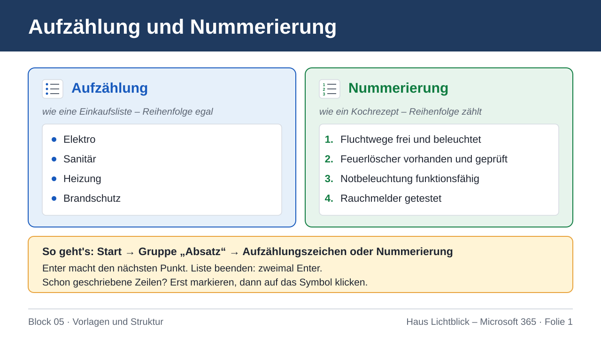
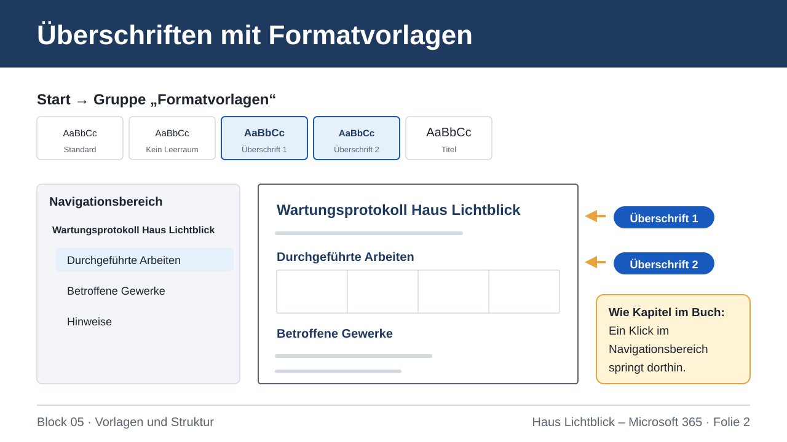
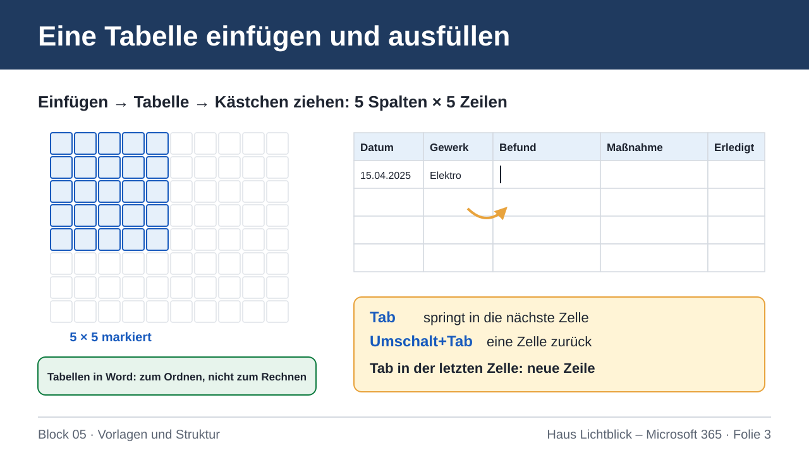
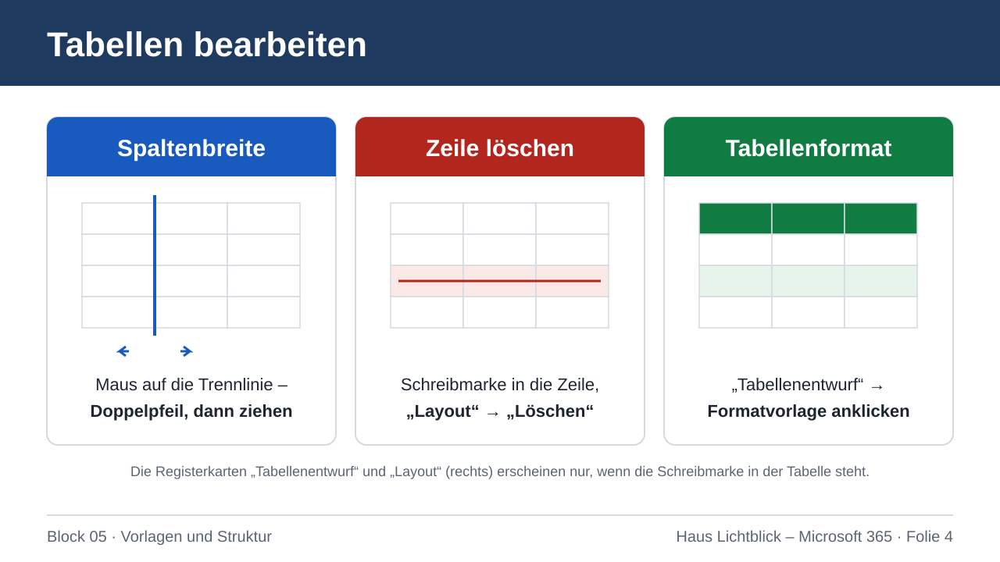
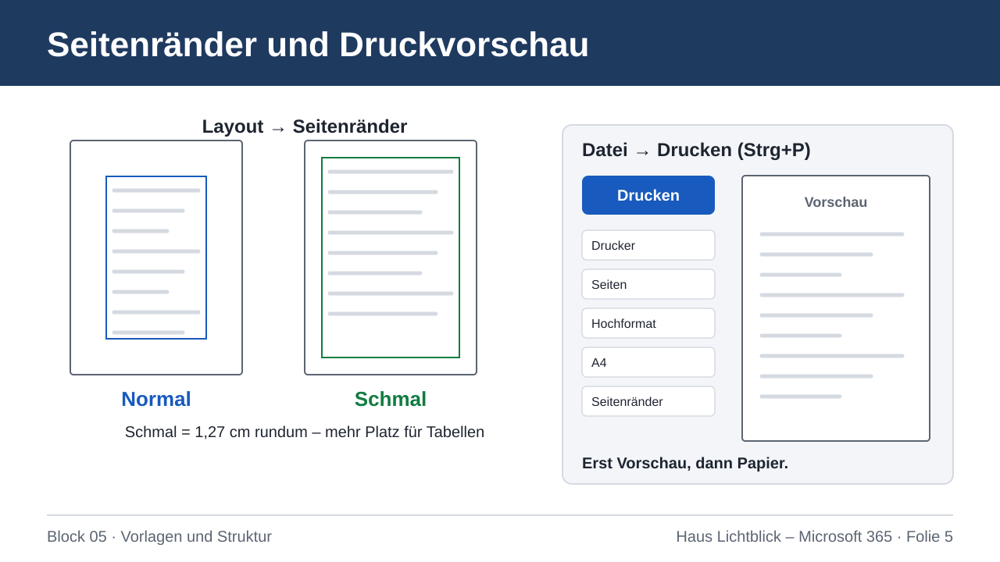

# Block 05 – Vorlagen und Struktur
{: .no_toc }

| | |
|---|---|
| **Programme** | Word |
| **Voraussetzung** | Block 04 |
| **Übungsblatt** | [Übungsblatt Block 05](Block-05-Uebungsblatt.md) |
| **Übungsdateien** | `Block-05-Wartungsprotokoll.docx`, `Block-05-Checkliste.docx` mit Lösungsdateien – siehe [unten](#uebungsdateien) |

Ein Aushang ist schnell geschrieben. Protokolle und Checklisten brauchen mehr: eine klare Gliederung, Listen und Tabellen. In diesem Block lernen Sie die Werkzeuge dafür. Statt Text von Hand groß und fett zu machen, nutzen Sie **Formatvorlagen** – fertige Vorlagen für Überschriften, die überall gleich aussehen.

{: .lernziele }
> - Aufzählungen und nummerierte Listen anlegen und beenden
> - Überschriften mit den Formatvorlagen „Überschrift 1“ und „Überschrift 2“ zuweisen
> - Mit dem Navigationsbereich durch ein Dokument springen
> - Eine Tabelle einfügen, ausfüllen und bearbeiten
> - Seitenränder ändern und ein Dokument in der Druckvorschau prüfen

Inhalt dieser Seite

- TOC
{:toc}

## Aufzählung und Nummerierung

| Liste | Vergleich | Wann? | Im Haus Lichtblick |
|---|---|---|---|
| **Aufzählung** (Punkte) | Einkaufsliste – die Reihenfolge ist egal | gleichrangige Punkte | betroffene Gewerke: Elektro, Sanitär, Heizung |
| **Nummerierung** (1., 2., 3.) | Kochrezept – die Reihenfolge zählt | Schritte, Prüfpunkte, auf die man sich bezieht | Checkliste Sicherheitsbegehung, Punkt 1 bis 8 |

**Eine Liste anlegen**

1. Klicken Sie in die Zeile, in der die Liste beginnen soll.
2. Klicken Sie auf der Registerkarte **„Start“** in der Gruppe **„Absatz“** auf **„Aufzählungszeichen“** oder **„Nummerierung“**.
3. Schreiben Sie den ersten Punkt und drücken Sie **Enter** – der nächste Punkt erscheint von selbst.
4. Fertig? Drücken Sie **zweimal Enter**. Die Liste endet, Sie schreiben normal weiter.

**Vorhandenen Text zur Liste machen:** Zeilen markieren, dann auf das Symbol klicken. Jeder Absatz wird ein Listenpunkt.

{: .tipp }
Aus Punkten Zahlen machen: Liste markieren und auf „Nummerierung“ klicken. Ein zweiter Klick auf dasselbe Symbol entfernt die Liste wieder.

## Überschriften mit Formatvorlagen

Überschriften sind wie Kapitel in einem Buch: **Überschrift 1** ist der Kapiteltitel, **Überschrift 2** der Abschnitt darin. Sie könnten Überschriften auch von Hand fett und groß machen – mit Formatvorlagen geht es schneller, alle Überschriften sehen gleich aus, und Word erkennt die Gliederung.

1. Klicken Sie in die Zeile, die eine Überschrift werden soll. Markieren ist nicht nötig.
2. Klicken Sie auf der Registerkarte **„Start“** in der Gruppe **„Formatvorlagen“** auf **„Überschrift 1“** (Hauptüberschrift) oder **„Überschrift 2“** (Abschnitt).
3. Normalen Text setzen Sie mit **„Standard“** zurück.

**Navigationsbereich:** Registerkarte **„Ansicht“** → Häkchen bei **„Navigationsbereich“**. Links erscheint die Gliederung aus Ihren Überschriften. Ein Klick springt an die Stelle – praktisch bei langen Protokollen.

{: .merke }
Formatvorlagen sind die „Vorlagen“ im Titel dieses Blocks. Sie gehören zu jedem Dokument. Ganze Dokumentvorlagen – etwa ein Briefbogen – kommen im Aufbaumodul Word.

## Eine Tabelle einfügen

Tabellen kennen Sie aus Excel. In Word sind sie zum **Ordnen** da, nicht zum Rechnen: Wartungsprotokolle, Raumlisten, Telefonlisten.

1. Klicken Sie an die Stelle, an der die Tabelle stehen soll.
2. Registerkarte **„Einfügen“** → **„Tabelle“**. Ein Raster aus Kästchen erscheint.
3. Fahren Sie mit der Maus über das Raster, bis 5 Kästchen nach rechts (Spalten) und 5 nach unten (Zeilen) farbig sind, und klicken Sie.
4. Die Schreibmarke steht in der ersten Zelle. Schreiben Sie die Spaltenüberschrift.
5. Drücken Sie **Tab**, um in die nächste Zelle zu springen. **Umschalt+Tab** springt zurück.

{: .tipp }
Zu wenig Zeilen? Drücken Sie in der **letzten Zelle** der Tabelle **Tab** – Word hängt eine neue Zeile an.

{: .achtung }
Drücken Sie in einer Tabelle nicht **Enter**, um in die nächste Zelle zu kommen. Enter macht die Zelle nur höher.

## Tabellen bearbeiten

Steht die Schreibmarke in einer Tabelle, erscheinen rechts im Menüband zwei zusätzliche Registerkarten: **„Tabellenentwurf“** und **„Layout“**.

| Was | So geht's |
|---|---|
| **Spaltenbreite ändern** | Maus auf die senkrechte Trennlinie, bis ein Doppelpfeil erscheint; mit gedrückter Maustaste ziehen. Doppelklick auf die Linie passt die Breite an den Inhalt an. |
| **Zeile einfügen** | In eine Zeile klicken, Registerkarte „Layout“ (rechts) → **„Darunter einfügen“**. |
| **Zeile löschen** | In die Zeile klicken, Registerkarte „Layout“ (rechts) → **„Löschen“** → **„Zeilen löschen“**. |
| **Kopfzeile hervorheben** | Erste Zeile markieren und fett machen – oder ein Tabellenformat wählen. |
| **Tabellenformat** | Registerkarte **„Tabellenentwurf“** → eine Vorlage aus dem Katalog „Tabellenformatvorlagen“ anklicken. |

{: .merke }
Es gibt zwei Registerkarten „Layout“: die normale für die ganze Seite und die Tabellen-Registerkarte ganz rechts. Für Zeilen und Spalten brauchen Sie die rechte.

## Seitenränder und Druckvorschau

**Seitenränder** sind der weiße Rand um den Text. Bei breiten Tabellen hilft ein schmalerer Rand.

1. Registerkarte **„Layout“** → **„Seitenränder“**.
2. Wählen Sie **„Schmal“** – 1,27 cm rundum. Die Werte jeder Einstellung stehen im Menü daneben.

**Druckvorschau:** **„Datei“** → **„Drucken“** (oder **Strg+P**). Rechts sehen Sie jede Seite so, wie sie gedruckt wird. Mit den Pfeilen unten blättern Sie durch mehrere Seiten.

{: .praxis }
Erst Vorschau, dann Papier: Ein Wartungsprotokoll, dessen letzte Tabellenspalte auf eine zweite Seite rutscht, sehen Sie in der Vorschau – nicht erst im Drucker.

{: .tipp }
Kein Drucker? Wählen Sie als Drucker **„Microsoft Print to PDF“**. Word speichert die Seite dann als PDF-Datei.

## Jetzt üben

{: .uebung }
> Laden Sie das [Übungsblatt Block 05](Block-05-Uebungsblatt.md) und die Übungsdateien herunter. Sie gliedern das Wartungsprotokoll mit Überschriften, füllen eine Tabelle mit den Wartungseinträgen und machen aus der Checkliste Sicherheitsbegehung eine nummerierte Liste zum Ausdrucken.

### Übungsdateien
{: #uebungsdateien }



## Häufige Fragen

**Kann ich das Aufzählungszeichen ändern?**
Ja. Klicken Sie auf den kleinen Pfeil neben „Aufzählungszeichen“ und wählen Sie ein anderes Zeichen.

**Warum sieht meine Überschrift anders aus als auf der Abbildung?**
Das Aussehen der Formatvorlagen hängt vom Design des Dokuments ab. Wichtig ist, dass es „Überschrift 1“ oder „Überschrift 2“ ist – das sehen Sie, wenn Sie hineinklicken: Die Vorlage ist im Katalog umrandet.

**Kann Word in Tabellen rechnen?**
Ein wenig, aber dafür ist Excel da. Ab Block 08 rechnen Sie in Excel.

**Die Nummerierung beginnt nicht bei 1.**
Rechtsklick auf die erste Zahl → **„Neu beginnen mit 1“**.

## Wenn es hakt

| Problem | Lösung |
|---|---|
| Die Liste hört nicht auf. | Zweimal Enter drücken. Oder in der leeren Zeile auf das Listensymbol klicken. |
| „Überschrift 1“ ist im Katalog nicht zu sehen. | Den Katalog mit dem kleinen Pfeil rechts aufklappen. |
| Die Tab-Taste springt nicht in die nächste Zelle. | Die Schreibmarke steht nicht in der Tabelle. Erst in eine Zelle klicken. |
| Die Registerkarten „Tabellenentwurf“ und „Layout“ fehlen. | Sie erscheinen nur, wenn die Schreibmarke in der Tabelle steht. |
| Die Spaltenbreite lässt sich nicht ziehen. | Genau auf die Trennlinie zeigen, bis der Doppelpfeil erscheint. |
| Drucken klappt nicht. | Drucker prüfen. Oder „Microsoft Print to PDF“ wählen. |

## Selbstcheck

Können Sie …

- [ ] eine Aufzählung und eine nummerierte Liste anlegen und beenden?
- [ ] Überschriften mit „Überschrift 1“ und „Überschrift 2“ zuweisen?
- [ ] den Navigationsbereich einblenden und damit springen?
- [ ] eine Tabelle mit fünf Spalten einfügen und mit Tab ausfüllen?
- [ ] eine Zeile anhängen und eine Zeile löschen?
- [ ] die Seitenränder auf „Schmal“ stellen und die Druckvorschau prüfen?

Wo Sie unsicher sind: den Abschnitt oben noch einmal lesen und die passende Aufgabe im Übungsblatt wiederholen.

## Für Coaching

{: .coaching }
> **Vorbereitung:** Word geöffnet, die Übungsdateien liegen im Ordner Downloads. Ein Drucker ist schön; sonst „Microsoft Print to PDF“.
>
> **Tempo:** Tabellen sind für Einsteigerinnen und Einsteiger am schwierigsten. Beim Einfügen über das Raster und beim Springen mit Tab besonders langsam vorgehen. Die Seitenränder können kurz bleiben – zeigen genügt.
>
> **Bildschirm teilen:** Zoom 100 %, andere Fenster schließen. Beim Zuweisen der Überschriften den Navigationsbereich offen lassen – so sieht man sofort, was die Formatvorlage bewirkt.
>
> **Erfolg sichtbar machen:** Die gedruckte Checkliste ist das greifbare Ergebnis dieses Blocks. Neben die Lösungsdatei legen und vergleichen.
>
> **Wer schneller ist:** ein Tabellenformat ausprobieren; die Spaltenbreiten so anpassen, dass jede Zeile der Tabelle einzeilig bleibt; in der Checkliste eine Spalte „erledigt“ als zweite Tabelle anlegen.

## Weiter

[Block 06 – Tagesrückblick und Fragen](Block-06.md) fasst Outlook und Word zusammen.
