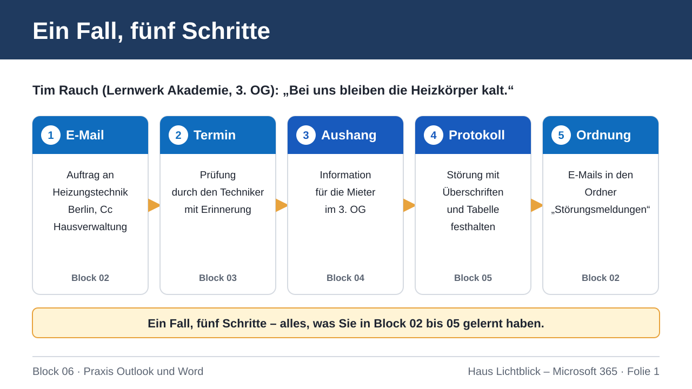
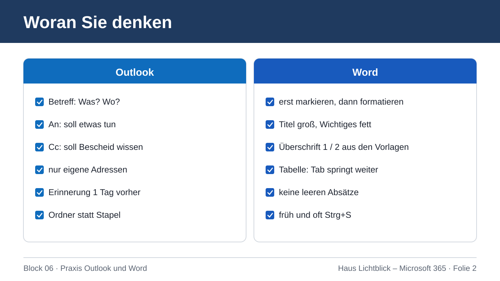

# Block 06 – Praxis Outlook und Word
{: .no_toc }

| | |
|---|---|
| **Programme** | Outlook, Word |
| **Voraussetzung** | Block 02 bis 05 |
| **Übungsblatt** | [Übungsblatt Block 06](Block-06-Uebungsblatt.md) |
| **Übungsdateien** | `Block-06-Aushang-Heizung.docx`, `Block-06-Stoerungsprotokoll.docx` mit Lösungsdateien – siehe [unten](#uebungsdateien) |

In diesem Block kommt nichts Neues dazu. Stattdessen setzen Sie alles ein, was Sie in Outlook und Word gelernt haben – an einem einzigen Fall aus dem Haus Lichtblick, von der ersten E-Mail bis zum fertigen Protokoll. So merken Sie, was schon sitzt und wo Sie noch einmal nachschlagen.

{: .lernziele }
> - Eine Störung mit Outlook weitergeben: E-Mail mit An, Cc und gutem Betreff
> - Einen Termin mit Erinnerung für die Prüfung anlegen
> - Einen Aushang für die Mieter in Word gestalten
> - Ein Störungsprotokoll mit Überschriften, Liste und Tabelle anlegen
> - E-Mails in einem Ordner ablegen und Übungstermine aufräumen

Inhalt dieser Seite

- TOC
{:toc}

## Der Fall

Montagmorgen im Haus Lichtblick. Tim Rauch von der Lernwerk Akademie im 3. OG ruft an: „Bei uns bleiben die Heizkörper kalt – in mehreren Büros.“ Heizungsausfall in einzelnen Räumen gehört zu den häufigsten Störungen im Haus. Jetzt sind Sie gefragt:

| Schritt | Was | Programm | Nachschlagen |
|---|---|---|---|
| 1 | Heizungstechnik Berlin beauftragen, die Hausverwaltung informieren | Outlook – E-Mail | [Block 02](Block-02.md) |
| 2 | Die Prüfung durch den Techniker in den Kalender eintragen | Outlook – Kalender | [Block 03](Block-03.md) |
| 3 | Die Mieter im 3. OG mit einem Aushang informieren | Word | [Block 04](Block-04.md) |
| 4 | Die Störung in einem Protokoll festhalten | Word | [Block 05](Block-05.md) |
| 5 | Die E-Mails ablegen, aufräumen | Outlook | [Block 02](Block-02.md), [Block 03](Block-03.md) |

{: .achtung }
Wie immer gilt: E-Mails und Einladungen nur an **Ihre eigene Adresse**. Heizungstechnik Berlin, die Hausverwaltung und alle anderen „spielen“ Sie selbst.

## Woran Sie denken

**In Outlook**

- Der Betreff sagt **was** und **wo**: „Heizungsausfall – …, 3. OG“.
- In **An** steht, wer etwas tun soll; in **Cc**, wer Bescheid wissen soll.
- Termine bekommen eine **Erinnerung**.
- Erledigte E-Mails kommen in einen **Ordner**.

**In Word**

- **Erst markieren, dann formatieren.**
- Ein Aushang muss aus der Entfernung lesbar sein: Titel groß, das Wichtigste fett.
- Überschriften kommen aus den **Formatvorlagen**, nicht von Hand.
- In Tabellen springt **Tab** in die nächste Zelle.
- Keine leeren Absätze für Abstand – und **früh und oft Strg+S**.

{: .tipp }
Arbeiten Sie mit dem Übungsblatt Schritt für Schritt. Wo Sie nicht weiterwissen, öffnen Sie den Block in der Spalte „Nachschlagen“ – genau dafür ist dieser Block da.

## Jetzt üben

{: .uebung }
> Laden Sie das [Übungsblatt Block 06](Block-06-Uebungsblatt.md) und die Übungsdateien herunter und arbeiten Sie den Fall „Heizung im 3. OG“ von der E-Mail bis zum Protokoll durch. Die Lösungsdateien zeigen, wie Aushang und Protokoll aussehen können.

### Übungsdateien
{: #uebungsdateien }



## Häufige Fragen

**Muss ich alles in einem Durchgang schaffen?**
Nein. Die fünf Schritte stehen jeder für sich. Sie können nach jedem Schritt eine Pause machen.

**Meine Lösung sieht anders aus als die Lösungsdatei. Ist sie falsch?**
Nicht unbedingt. Ein Aushang ist gut, wenn man ihn aus der Entfernung lesen kann und das Wichtigste sofort sieht. Schriftgrößen und Formulierungen dürfen abweichen.

**Ich habe vieles nachschlagen müssen.**
Das ist der Sinn dieses Blocks. Notieren Sie, was Sie nachgeschlagen haben – das sind die Themen für den Selbsttest in Block 07.

## Wenn es hakt

| Problem | Nachschlagen |
|---|---|
| Cc-Zeile fehlt, Betreff fällt schwer | [Block 02 – E-Mail-Grundlagen](Block-02.md) |
| Erinnerung oder Termin klappt nicht | [Block 03 – Kalender und Termine](Block-03.md) |
| Formatierung wird nicht übernommen, leere Absätze | [Block 04 – Texte erstellen, formatieren und speichern](Block-04.md) |
| Überschriften, Liste oder Tabelle | [Block 05 – Vorlagen und Struktur](Block-05.md) |
| Fenster nebeneinander | [Block 01 – Orientierung in Microsoft 365](Block-01.md) |

## Selbstcheck

Können Sie …

- [ ] eine E-Mail mit An, Cc und gutem Betreff ohne Nachschlagen schreiben?
- [ ] einen Termin mit Erinnerung anlegen und wieder löschen?
- [ ] einen Aushang so gestalten, dass man ihn aus der Entfernung lesen kann?
- [ ] ein Protokoll mit Überschriften, nummerierter Liste und Tabelle anlegen?
- [ ] E-Mails in einen Ordner verschieben?

Wo Sie nachschlagen mussten: Diese Themen wiederholen Sie im [Selbsttest in Block 07](Block-07.md).

## Für Coaching

{: .coaching }
> **Vorbereitung:** Outlook und Word sind offen, die Übungsdateien liegen im Ordner Downloads. Die eigene Adresse für den Versand ist geklärt.
>
> **Tempo:** Die lernende Person arbeitet selbstständig. Nur eingreifen, wenn sie festhängt – und dann zuerst auf den Block zum Nachschlagen verweisen, bevor Sie es zeigen.
>
> **Bildschirm teilen:** Die lernende Person teilt ihren Bildschirm, nicht Sie. Laut denken lassen: „Was machen Sie als Nächstes?“
>
> **Erfolg sichtbar machen:** Am Ende E-Mail, Termin, Aushang und Protokoll nebeneinander ansehen. Das ist ein vollständiger Arbeitsvorgang aus dem Facility Management.
>
> **Wer schneller ist:** einen zweiten Fall aus den häufigen Störungsmeldungen der Referenzliste durchspielen, etwa „Verstopfte Toiletten“ im 2. OG.

## Weiter

In [Block 07 – Selbsttest Outlook und Word](Block-07.md) prüfen Sie Ihr Wissen mit einem Quiz und kurzen Trainingsaufgaben, bevor es mit Excel weitergeht.
