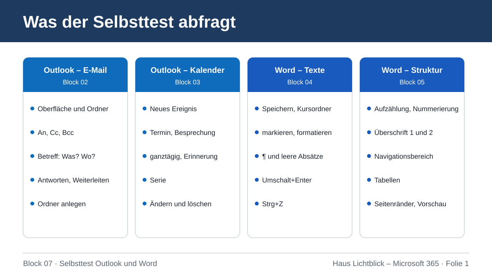
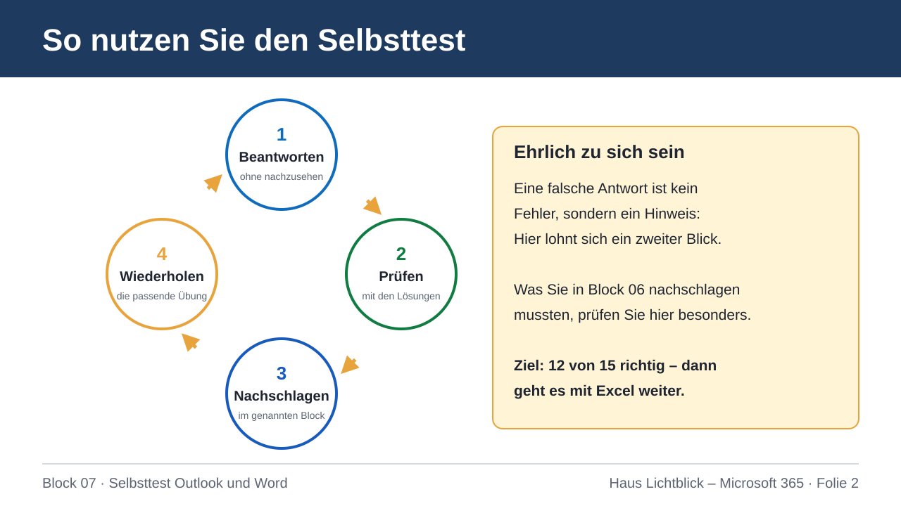

# Block 07 – Selbsttest Outlook und Word
{: .no_toc }

| | |
|---|---|
| **Programme** | Outlook, Word |
| **Voraussetzung** | Block 02 bis 06 |
| **Übungsblatt** | [Übungsblatt Block 07](Block-07-Uebungsblatt.md) |
| **Übungsdateien** | `Block-07-Training.docx`, Lösung `Block-07-Loesung-Training.docx` – siehe [unten](#uebungsdateien) |

Bevor es mit Excel weitergeht, prüfen Sie, was aus Outlook und Word sitzt. Der Selbsttest hat drei Teile: ein Quiz mit 15 Fragen, ein Word-Trainingsdokument mit sieben kurzen Aufgaben und drei schnelle Aufgaben in Outlook. Zu jeder Frage steht dabei, in welchem Block Sie nachschlagen können.

{: .lernziele }
> - Den eigenen Stand in Outlook und Word ehrlich einschätzen
> - Lücken erkennen und gezielt im passenden Block nachschlagen
> - Kurze Aufgaben in Word und Outlook ohne Anleitung lösen

Inhalt dieser Seite

- TOC
{:toc}

## Was der Selbsttest abfragt

| Bereich | Themen | Block |
|---|---|---|
| Outlook – E-Mail | Oberfläche, An/Cc/Bcc, Betreff, Antworten und Weiterleiten, Ordner | [02](Block-02.md) |
| Outlook – Kalender | Neues Ereignis, Termin/Besprechung/ganztägig, Erinnerung, Serie | [03](Block-03.md) |
| Word – Texte | Speichern, markieren und formatieren, Absatzzeichen, Umschalt+Enter, Strg+Z | [04](Block-04.md) |
| Word – Struktur | Listen, Überschriften, Navigationsbereich, Tabellen, Seitenränder und Vorschau | [05](Block-05.md) |

## So nutzen Sie den Selbsttest

1. **Beantworten** Sie die Fragen, ohne nachzusehen.
2. **Prüfen** Sie mit den Lösungen am Ende des Übungsblatts.
3. **Schlagen** Sie bei jeder falschen oder unsicheren Antwort im genannten Block **nach**.
4. **Wiederholen** Sie die passende Aufgabe im Übungsblatt dieses Blocks.

{: .merke }
Eine falsche Antwort ist kein Fehler, sondern ein Hinweis: Hier lohnt sich ein zweiter Blick. Ziel sind **12 von 15** richtigen Antworten im Quiz – dann sind Sie bereit für Excel.

{: .tipp }
Haben Sie in Block 06 notiert, wo Sie nachschlagen mussten? Nehmen Sie die Liste dazu und achten Sie bei diesen Themen besonders auf Ihre Antworten.

## Jetzt üben

{: .uebung }
> Laden Sie das [Übungsblatt Block 07](Block-07-Uebungsblatt.md) und das Trainingsdokument herunter. Sie beantworten das Quiz, lösen die Trainingsaufgaben in Word und drei kurze Aufgaben in Outlook.

### Übungsdateien
{: #uebungsdateien }



## Häufige Fragen

**Ich habe weniger als 12 richtige Antworten. Soll ich trotzdem mit Excel anfangen?**
Ja, wenn Sie die Lücken kennen. Excel baut nicht auf Outlook auf; aus Word brauchen Sie vor allem das Speichern. Wiederholen Sie die unsicheren Themen nebenbei.

**Darf ich beim Trainingsdokument nachsehen?**
Versuchen Sie es zuerst ohne. Wenn Sie nicht weiterkommen, ist das ein Thema für den zweiten Blick – dann nachsehen und notieren.

## Wenn es hakt

| Thema | Nachschlagen |
|---|---|
| An, Cc, Bcc, Betreff, Ordner | [Block 02 – E-Mail-Grundlagen](Block-02.md) |
| Termin, Serie, Erinnerung | [Block 03 – Kalender und Termine](Block-03.md) |
| Formatieren, Absätze, Speichern | [Block 04 – Texte erstellen, formatieren und speichern](Block-04.md) |
| Listen, Überschriften, Tabellen, Druck | [Block 05 – Vorlagen und Struktur](Block-05.md) |

## Selbstcheck

Können Sie …

- [ ] mindestens 12 der 15 Quizfragen richtig beantworten?
- [ ] die sieben Aufgaben im Trainingsdokument ohne Nachsehen lösen?
- [ ] eine E-Mail mit Bcc senden, mit Kommentar weiterleiten und ein ganztägiges Ereignis anlegen?
- [ ] für jedes Thema, bei dem Sie unsicher waren, den passenden Block nennen?

## Für Coaching

{: .coaching }
> **Vorbereitung:** Outlook und Word sind offen, das Trainingsdokument liegt im Ordner Downloads.
>
> **Tempo:** Das Quiz still allein bearbeiten lassen, ohne Hilfe. Erst danach gemeinsam auswerten.
>
> **Auswertung:** Die lernende Person antworten lassen, nicht selbst vorwegnehmen. Falsche Antworten wertschätzend aufgreifen („Fast – schauen wir kurz in Block 04 nach …“) und direkt am Bildschirm zeigen.
>
> **Erfolg sichtbar machen:** Die Zahl der richtigen Antworten mit dem Gefühl vor dem Test vergleichen – meist ist es mehr, als die lernende Person erwartet hat.
>
> **Offene Fragen:** Was länger dauert, notieren und nach dem Start mit Excel wieder aufgreifen.

## Weiter

Jetzt kommt das dritte Programm: In [Block 08 – Excel-Grundlagen](Block-08.md) lernen Sie Excel kennen und schreiben Ihre erste Formel.
