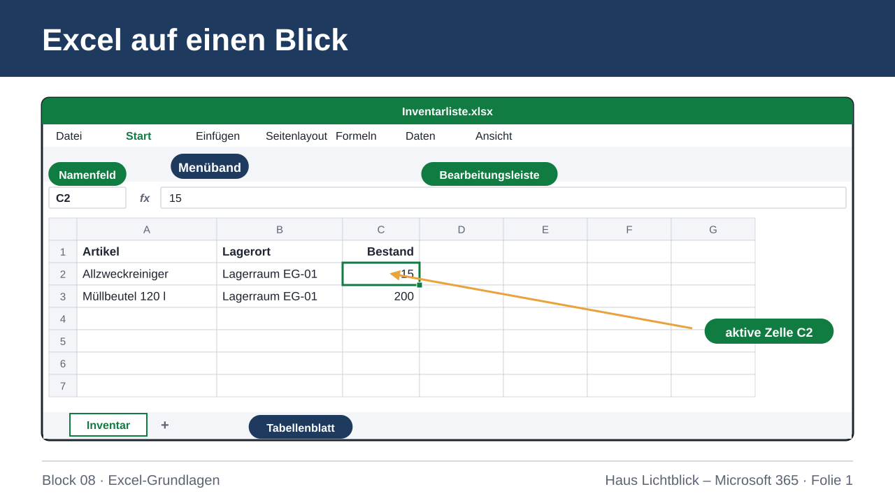
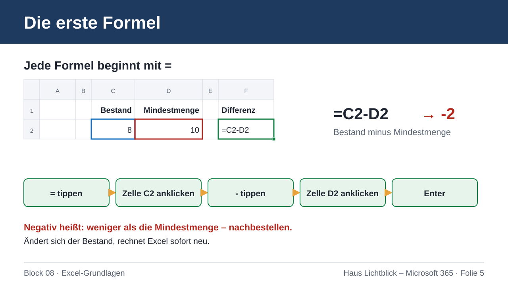

# Block 08 – Excel-Grundlagen
{: .no_toc }

| | |
|---|---|
| **Programme** | Excel |
| **Voraussetzung** | Block 01 und 04 (Speichern) |
| **Übungsblatt** | [Übungsblatt Block 08](Block-08-Uebungsblatt.md) |
| **Übungsdateien** | `Block-08-Inventarliste.xlsx`, Lösung `Block-08-Loesung-Inventarliste.xlsx` – siehe [unten](#uebungsdateien) |

Jetzt kommt das dritte Programm: Excel, Ihr Werkzeug für Listen und Zahlen. Im Haus Lichtblick führen Sie damit zum Beispiel die Inventarliste des Reinigungsmaterials im Lager. In diesem Block lernen Sie, wie Excel aufgebaut ist, wie Sie sich bewegen, Daten eingeben und Ihre erste Formel schreiben.

{: .lernziele }
> - Die Excel-Oberfläche benennen: Zelle, Spalte, Zeile, Namenfeld, Bearbeitungsleiste, Tabellenblatt
> - Zwischen Zellen wechseln – mit Pfeiltasten, Strg+Pos1 und dem Namenfeld
> - Text, Zahlen und Datumsangaben eingeben und ändern
> - Spaltenbreiten anpassen und die Kopfzeile hervorheben
> - Eine einfache Formel mit Zellbezügen eingeben

Inhalt dieser Seite

- TOC
{:toc}

## Excel auf einen Blick

Excel ist wie ein riesiges Rechenpapier mit Kästchen. Jedes Kästchen – jede **Zelle** – kann einen Text, eine Zahl oder eine Formel aufnehmen.

| Begriff | Was ist das? |
|---|---|
| **Zelle** | ein Kästchen, zum Beispiel C2 |
| **Spalte** | senkrecht, oben mit Buchstaben benannt: A, B, C … |
| **Zeile** | waagerecht, links mit Zahlen benannt: 1, 2, 3 … |
| **Aktive Zelle** | die Zelle mit dem grünen Rahmen – hier landet, was Sie tippen |
| **Namenfeld** | links über dem Raster; zeigt die Adresse der aktiven Zelle |
| **Bearbeitungsleiste** | rechts daneben; zeigt den Inhalt der aktiven Zelle – bei Formeln die Formel |
| **Tabellenblatt** | die Registerkarte unten, zum Beispiel „Inventar“ – wie eine Seite in einem Heft |
| **Arbeitsmappe** | die ganze Excel-Datei mit allen Tabellenblättern |

## Zellen und Adressen

Jede Zelle hat eine **Adresse**: erst der Buchstabe der Spalte, dann die Zahl der Zeile – wie ein Planquadrat auf dem Stadtplan. C4 ist die Zelle in Spalte C, Zeile 4.

| Taste | Wirkung |
|---|---|
| **Pfeiltasten** | eine Zelle weiter in Pfeilrichtung |
| **Enter** | eine Zelle nach unten |
| **Tab** | eine Zelle nach rechts |
| **Strg+Pos1** | zurück nach A1 |
| **Namenfeld** | hineinklicken, Adresse tippen (zum Beispiel `C9`), Enter – Excel springt hin |

{: .tipp }
Mit **Strg+Pfeil nach unten** springen Sie ans Ende einer Liste – praktisch bei langen Tabellen.

## Daten eingeben

1. Klicken Sie die Zelle an.
2. Tippen Sie den Inhalt.
3. Bestätigen Sie mit **Enter** (nach unten) oder **Tab** (nach rechts).

| Eingabe | Beispiel | Excel zeigt |
|---|---|---|
| Text | Glasreiniger | linksbündig |
| Zahl | 8 | rechtsbündig – Excel kann damit rechnen |
| Datum | 15.04.2025 – mit Punkten | rechtsbündig – auch mit einem Datum kann Excel rechnen |

**Ändern:** Zelle anklicken und einfach neu tippen – der alte Inhalt wird ersetzt. Nur einen Teil ändern: **F2** drücken oder in die Bearbeitungsleiste klicken. **Esc** bricht eine Eingabe ab, **Entf** leert die Zelle.

{: .merke }
Steht eine Zahl **links** in der Zelle, hält Excel sie für Text und rechnet nicht damit. Meist ist ein Leerzeichen oder ein Buchstabe dazwischengeraten. Zelle leeren und neu eingeben.

{: .achtung }
**######** ist kein Fehler im Wert: Die Spalte ist nur zu schmal für die Zahl oder das Datum. Machen Sie die Spalte breiter.

## Spaltenbreite und Kopfzeile

**Spaltenbreite anpassen**

1. Zeigen Sie mit der Maus oben im Spaltenkopf genau auf die **Trennlinie** rechts neben dem Buchstaben. Der Mauszeiger wird zum Doppelpfeil.
2. **Doppelklicken** Sie. Die Spalte passt sich dem längsten Eintrag an.
3. Oder ziehen Sie die Linie mit gedrückter Maustaste auf die gewünschte Breite.

{: .tipp }
Mehrere Spalten auf einmal: Spaltenköpfe A bis E mit gedrückter Maustaste markieren, dann auf eine der Trennlinien doppelklicken.

**Kopfzeile hervorheben**

1. Markieren Sie die Zellen der Kopfzeile mit gedrückter Maustaste.
2. Klicken Sie auf der Registerkarte **„Start“** auf **F** (Fett) oder drücken Sie **Strg+Umschalt+F**.
3. Klicken Sie auf den kleinen Pfeil neben **„Füllfarbe“** (Farbeimer) und wählen Sie ein helles Grün.

## Die erste Formel

Mit Formeln rechnet Excel für Sie. Jede Formel beginnt mit einem **Gleichheitszeichen**. Es sagt Excel: „Rechne das aus.“

Im Haus Lichtblick wollen Sie wissen, ob genug Material im Lager ist: **Differenz = Bestand − Mindestmenge**. Ist das Ergebnis negativ, liegt der Bestand unter der Mindestmenge – Sie müssen nachbestellen.

1. Klicken Sie in die Zelle, in der das Ergebnis stehen soll, zum Beispiel F5.
2. Tippen Sie **=**.
3. Klicken Sie auf die Zelle mit dem Bestand (C5). Excel schreibt `C5` in die Formel und umrahmt die Zelle farbig.
4. Tippen Sie **-** (Minus).
5. Klicken Sie auf die Zelle mit der Mindestmenge (D5).
6. Drücken Sie **Enter**. In der Zelle steht das Ergebnis, in der Bearbeitungsleiste die Formel `=C5-D5`.

{: .merke }
Rechnen Sie mit **Zelladressen**, nicht mit abgetippten Zahlen. Schreiben Sie `=C5-D5`, nicht `=15-10`. Dann rechnet Excel von selbst neu, wenn sich der Bestand ändert.

| Rechenart | Zeichen | Beispiel |
|---|---|---|
| Plus | + | `=C5+C6` |
| Minus | - | `=C5-D5` |
| Mal | * | `=C5*2` |
| Geteilt | / | `=C5/2` |

{: .tipp }
In Block 09 lernen Sie, wie Sie eine Formel mit einem Zug für alle Zeilen übernehmen. Bis dahin tippen Sie sie für jede Zeile – gute Übung.

## Speichern

Excel-Dateien speichern Sie wie Word-Dateien (Block 04): **Strg+S**, beim ersten Mal Name und Ordner wählen. Excel-Dateien enden auf **.xlsx**.

## Jetzt üben

{: .uebung }
> Laden Sie das [Übungsblatt Block 08](Block-08-Uebungsblatt.md) und die Übungsdatei herunter. Sie ergänzen die Inventarliste des Reinigungsmaterials, bringen sie in Form und berechnen mit einer Formel, welche Artikel nachbestellt werden müssen.

### Übungsdateien
{: #uebungsdateien }



## Häufige Fragen

**Wozu brauche ich Excel, wenn Word auch Tabellen kann?**
Word-Tabellen ordnen Text. Excel rechnet: Bestände, Verbräuche, Kosten. Ändert sich eine Zahl, stimmen alle Ergebnisse sofort wieder.

**Warum steht in der Zelle eine Zahl, in der Bearbeitungsleiste aber eine Formel?**
Die Zelle zeigt das Ergebnis, die Bearbeitungsleiste die Rechnung dahinter. So erkennen Sie, ob eine Zahl getippt oder berechnet ist.

**Was ist der Unterschied zwischen Tabellenblatt und Arbeitsmappe?**
Die Arbeitsmappe ist die Datei, die Tabellenblätter sind die Seiten darin. Ein neues Blatt legen Sie mit dem **+** neben den Registern an.

## Wenn es hakt

| Problem | Lösung |
|---|---|
| Die Formel steht als Text in der Zelle. | Das Gleichheitszeichen fehlt. Zelle leeren und mit `=` neu beginnen. |
| Die Zelle zeigt `#NAME?`. | Ein Name in der Formel ist falsch geschrieben. Formel prüfen. |
| Die Zelle zeigt `######`. | Die Spalte ist zu schmal. Breiter machen. |
| Excel macht aus einer Eingabe ein Datum. | Excel hält „1.4“ für den 1. April. Rechtsklick → „Zellen formatieren“ → „Zahl“, dann neu eingeben. |
| Beim Tippen in der Formel ändert sich eine andere Zelle. | Sie haben eine Pfeiltaste gedrückt – das wählt in Formeln eine Zelle. Mit der Maus klicken oder Esc und neu beginnen. |
| Aus Versehen etwas gelöscht. | **Strg+Z**, auch mehrmals. |
| „Geschützte Ansicht“, ich kann nichts eingeben. | Auf „Bearbeitung aktivieren“ klicken. |

## Selbstcheck

Können Sie …

- [ ] Zelle, Spalte, Zeile, Namenfeld und Bearbeitungsleiste zeigen?
- [ ] mit dem Namenfeld zu einer Zelle springen und mit Strg+Pos1 zurück nach A1?
- [ ] Text, Zahlen und ein Datum eingeben und eine Eingabe ändern?
- [ ] Spaltenbreiten mit Doppelklick anpassen?
- [ ] die Kopfzeile fett machen und farbig hinterlegen?
- [ ] eine Formel wie `=C5-D5` mit Mausklicks eingeben und erklären, was sie rechnet?

Wo Sie unsicher sind: den Abschnitt oben noch einmal lesen und die passende Aufgabe im Übungsblatt wiederholen.

## Für Coaching

{: .coaching }
> **Vorbereitung:** Excel ist angemeldet, die Übungsdatei liegt im Ordner Downloads. Zoom auf mindestens 125 % (unten rechts in der Statusleiste), sonst sind die Zellen beim Teilen des Bildschirms schwer zu lesen.
>
> **Tempo:** Sehr langsam bei Adressen und Namenfeld – viele kennen das Namenfeld nicht. Bei der Formel auf die Farben achten lassen: Excel umrahmt jede Zelle, die in der Formel vorkommt, in derselben Farbe.
>
> **Bildschirm teilen:** Jeden Klick ansagen. Den Doppelklick auf die Spaltentrennlinie zeigen – er sorgt regelmäßig für ein kleines Aha-Erlebnis.
>
> **Erfolg sichtbar machen:** Den Bestand von Glasreiniger ändern und zusehen, wie die Differenz sofort mitrechnet. Das zeigt besser als jede Erklärung, warum man mit Zelladressen rechnet.
>
> **Wer schneller ist:** ein zweites Tabellenblatt anlegen und umbenennen (Doppelklick auf das Register); die negativen Differenzen rot färben.

## Weiter

In [Block 09 – Rechnen und Auswerten](Block-09.md) übernehmen Sie Formeln für ganze Spalten und rechnen mit SUMME, MITTELWERT und Co.
