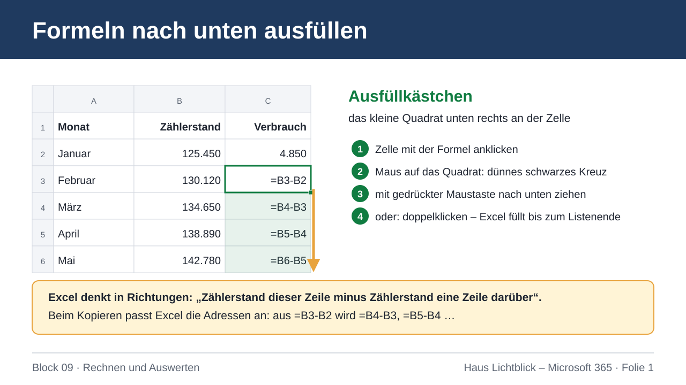
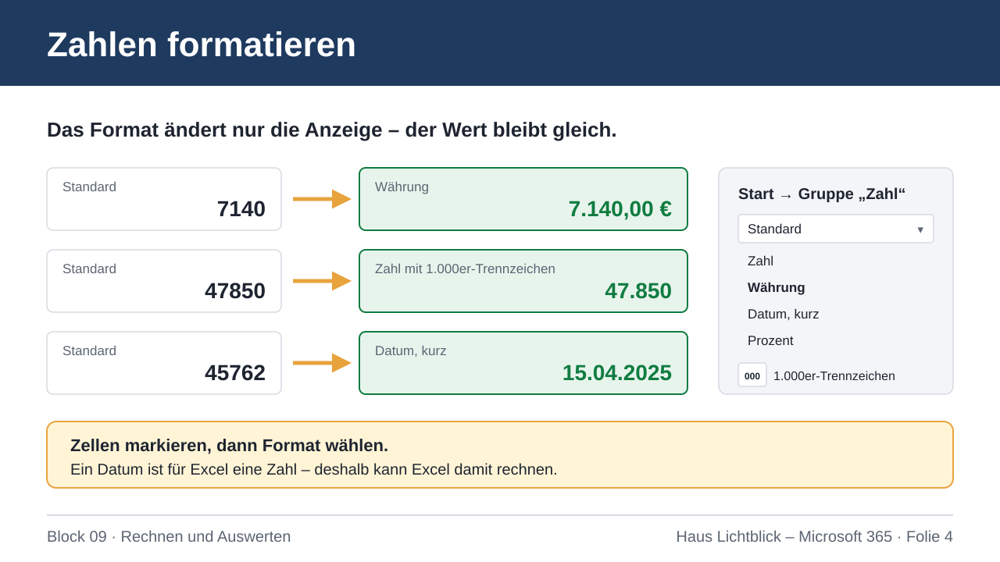

# Block 09 – Rechnen und Auswerten
{: .no_toc }

| | |
|---|---|
| **Programme** | Excel |
| **Voraussetzung** | Block 08 |
| **Übungsblatt** | [Übungsblatt Block 09](Block-09-Uebungsblatt.md) |
| **Übungsdateien** | `Block-09-Auswertung.xlsx`, Lösung `Block-09-Loesung-Auswertung.xlsx` – siehe [unten](#uebungsdateien) |

In Block 08 haben Sie Ihre erste Formel geschrieben – Zeile für Zeile. Jetzt geht es schneller: Sie übernehmen eine Formel mit einem Zug für eine ganze Spalte, rechnen mit Funktionen wie SUMME und MITTELWERT und lassen sich mit Sortieren und Filtern genau die Zeilen zeigen, die Sie gerade brauchen. Grundlage ist der Stromverbrauch des Hauses Lichtblick im Jahr 2025.

{: .lernziele }
> - Eine Formel mit dem Ausfüllkästchen auf weitere Zellen übertragen und erklären, warum Excel die Adressen anpasst
> - Die Funktionen SUMME, MITTELWERT, MIN, MAX und ANZAHL eingeben
> - AutoSumme nutzen
> - Zahlen als Währung, mit Tausendertrennzeichen und als Datum formatieren
> - Eine Liste sortieren und filtern – und den Filter wieder aufheben

Inhalt dieser Seite

- TOC
{:toc}

## Formeln nach unten ausfüllen

Der Stromverbrauch eines Monats ist der Zählerstand am Monatsende minus der Zählerstand vom Vormonat. Für Februar: `=B5-B4`. Diese Formel brauchen Sie für elf Monate – Sie schreiben sie aber nur einmal.

1. Klicken Sie die Zelle mit der fertigen Formel an.
2. Unten rechts am grünen Rahmen sitzt ein kleines Quadrat, das **Ausfüllkästchen**. Zeigen Sie mit der Maus darauf – der Mauszeiger wird zu einem dünnen schwarzen Kreuz.
3. Ziehen Sie mit gedrückter Maustaste nach unten bis zur letzten Zeile und lassen Sie los.

{: .tipp }
Noch schneller: **Doppelklick** auf das Ausfüllkästchen. Excel füllt bis zum Ende der Liste aus.

**Warum stimmt das?** Excel merkt sich eine Formel nicht als feste Adressen, sondern als Richtung: „die Zelle links in dieser Zeile minus die Zelle links eine Zeile darüber“. Beim Kopieren passt Excel die Adressen deshalb an: Aus `=B5-B4` wird `=B6-B5`, `=B7-B6` und so weiter. Man nennt das **relative Bezüge**.

{: .merke }
Prüfen Sie nach dem Ausfüllen eine Zelle weiter unten: Anklicken und in die Bearbeitungsleiste schauen. Steht dort die passende Formel dieser Zeile, ist alles richtig.

## Funktionen: SUMME, MITTELWERT, MIN, MAX, ANZAHL

Eine **Funktion** ist eine fertige Rechnung mit einem Namen. Sie geben Excel nur noch den **Bereich** – die Zellen, mit denen gerechnet wird.

`=SUMME(C4:C15)` heißt: „Zähle alle Zahlen von C4 **bis** C15 zusammen.“ Der Doppelpunkt bedeutet „bis“.

| Funktion | Rechnet | Vergleich | Strom 2025 |
|---|---|---|---|
| `=SUMME(C4:C15)` | alles zusammen | der Kassenzettel | 47.850 kWh |
| `=MITTELWERT(C4:C15)` | den Durchschnitt | „Was verbrauchen wir normalerweise im Monat?“ | 3.987,5 kWh |
| `=MIN(C4:C15)` | den kleinsten Wert | der sparsamste Monat | 3.240 kWh |
| `=MAX(C4:C15)` | den größten Wert | der teuerste Monat | 4.850 kWh |
| `=ANZAHL(C4:C15)` | wie viele Zellen eine Zahl enthalten | Sind alle Monate erfasst? | 12 |

**Eine Funktion eintippen**

1. Klicken Sie in die Zelle für das Ergebnis.
2. Tippen Sie `=SUMME(` – Excel zeigt beim Tippen passende Funktionen und einen kleinen Hinweis.
3. Markieren Sie mit der Maus den Bereich, zum Beispiel C4 bis C15. Excel trägt `C4:C15` ein.
4. Tippen Sie `)` und drücken Sie **Enter**.

{: .achtung }
Funktionen in Excel heißen auf Deutsch: SUMME, nicht SUM; MITTELWERT, nicht AVERAGE. Die Argumente trennt ein **Semikolon**, kein Komma.

## Schneller mit AutoSumme

1. Klicken Sie in die Zelle **unter** einer Zahlenreihe.
2. Klicken Sie auf der Registerkarte **„Start“** (oder „Formeln“) auf **„AutoSumme“** (Σ).
3. Excel schlägt einen Bereich vor und umrahmt ihn gestrichelt. Stimmt er, drücken Sie **Enter**. Stimmt er nicht, markieren Sie vorher den richtigen Bereich mit der Maus.

Der kleine Pfeil neben „AutoSumme“ bietet auch **Mittelwert**, **Anzahl**, **Max** und **Min**.

{: .achtung }
AutoSumme nimmt alle Zahlen über der Zelle bis zur ersten Lücke. Steht über der Reihe eine Jahreszahl oder ein anderer Wert, rechnet Excel ihn mit. Den Bereich immer prüfen.

## Zahlen formatieren

Das Zahlenformat ändert, **wie** eine Zahl angezeigt wird – nicht den Wert. 7140 bleibt 7140, auch wenn dort „7.140,00 €“ steht.

1. Markieren Sie die Zellen.
2. Wählen Sie auf der Registerkarte **„Start“** in der Gruppe **„Zahl“** das Format aus der Liste, zum Beispiel **„Währung“**.

| Format | Vorher | Nachher | Wofür |
|---|---|---|---|
| Währung | 7140 | 7.140,00 € | Nebenkosten, Rechnungen |
| 1.000er-Trennzeichen (Schaltfläche „000“) | 47850 | 47.850,00 | große Zahlen wie Zählerstände |
| Datum, kurz | 45762 | 15.04.2025 | Termine, Fristen |

{: .tipp }
Zu viele Nachkommastellen? Daneben gibt es die Schaltflächen **„Dezimalstelle hinzufügen“** und **„Dezimalstelle löschen“**. Zweimal „löschen“ macht aus 47.850,00 wieder 47.850.

{: .merke }
Ein Datum ist für Excel eine fortlaufende Zahl – der 15.04.2025 ist Tag 45762. Deshalb kann Excel mit Datumsangaben rechnen, zum Beispiel die Tage bis zur nächsten Wartung.

## Sortieren und Filtern

**Sortieren** ändert die Reihenfolge der Zeilen, zum Beispiel vom kleinsten zum größten Bestand.

1. Klicken Sie **eine Zelle** in der Spalte an, nach der sortiert werden soll – nicht die ganze Spalte markieren.
2. Registerkarte **„Daten“** → **„Sortieren“**.
3. Wählen Sie unter „Sortieren nach“ die Spalte und unter „Reihenfolge“ zum Beispiel **„Nach Größe (aufsteigend)“**. Klicken Sie auf **„OK“**.

**Filtern** zeigt nur die Zeilen, die Sie sehen wollen – zum Beispiel nur die Artikel, die nachbestellt werden müssen.

1. Klicken Sie eine Zelle in der Liste an.
2. Registerkarte **„Daten“** → **„Filtern“**. In jeder Spaltenüberschrift erscheint ein kleiner Pfeil.
3. Klicken Sie auf den Pfeil der Spalte, zum Beispiel „Nachbestellen“.
4. Entfernen Sie das Häkchen bei **„(Alle auswählen)“** und setzen Sie es nur bei **„Ja“**. Klicken Sie auf **„OK“**.

Die übrigen Zeilen sind jetzt **ausgeblendet, nicht gelöscht**. Sie erkennen es an den Zeilennummern: Sie springen, und sie sind blau.

**Filter aufheben:** Registerkarte „Daten“ → noch einmal auf **„Filtern“** klicken. Alle Zeilen sind wieder da, die Pfeile verschwinden.

{: .tipp }
Über den Pfeil in der Spaltenüberschrift können Sie auch sortieren: „Nach Größe sortieren (aufsteigend)“ – oder bei Text „Von A bis Z sortieren“.

{: .praxis }
Vor einer Bestellung filtern Sie die Inventarliste auf „Nachbestellen = Ja“ und schicken genau diese Zeilen an den Einkauf.

## Jetzt üben

{: .uebung }
> Laden Sie das [Übungsblatt Block 09](Block-09-Uebungsblatt.md) und die Übungsdatei herunter. Sie berechnen den Stromverbrauch 2025 Monat für Monat, werten ihn mit Funktionen aus, summieren die Nebenkosten der Mieter in Euro und filtern die Inventarliste.

### Übungsdateien
{: #uebungsdateien }



## Häufige Fragen

**Muss ich die Formel für jede Zeile neu tippen?**
Nein. Einmal schreiben, mit dem Ausfüllkästchen nach unten ziehen. Das ist der große Vorteil von Excel.

**Was ist der Unterschied zwischen ANZAHL und SUMME?**
SUMME zählt die **Werte** zusammen (4.850 + 4.670 + …), ANZAHL zählt die **Zellen**, in denen eine Zahl steht (12).

**Sind beim Filtern Daten verloren?**
Nein. Die Zeilen sind nur ausgeblendet. Filter aufheben, und alles ist wieder da.

**Warum steht beim Mittelwert eine Kommazahl?**
Der Durchschnitt geht selten glatt auf. Mit „Dezimalstelle löschen“ runden Sie die Anzeige – der Wert dahinter bleibt genau.

## Wenn es hakt

| Problem | Lösung |
|---|---|
| Das Ausfüllkästchen ist nicht zu finden. | Erst die Zelle anklicken; das Quadrat sitzt unten rechts am grünen Rahmen. Alternativ: Zelle kopieren (Strg+C), Zielzellen markieren, einfügen (Strg+V). |
| Nach dem Ziehen steht überall dieselbe Zahl. | Es wurde eine Zahl statt einer Formel kopiert. Prüfen, ob die erste Zelle mit `=` beginnt. |
| Die Zelle zeigt `#NAME?`. | Funktionsname falsch geschrieben, etwa „SUME“. Korrigieren. |
| Die Zelle zeigt `#WERT!`. | Im Bereich steht Text statt einer Zahl. Bereich prüfen. |
| Die Zelle zeigt `#DIV/0!`. | MITTELWERT über leere Zellen. Bereich prüfen. |
| Nach dem Sortieren passen Artikel und Bestand nicht mehr zusammen. | Sofort **Strg+Z**. Beim nächsten Mal nur eine Zelle anklicken, nicht die Spalte markieren. |
| Die Filterpfeile fehlen. | Eine Zelle in der Liste anklicken, dann „Daten“ → „Filtern“. |

## Selbstcheck

Können Sie …

- [ ] eine Formel mit dem Ausfüllkästchen nach unten ziehen und prüfen, ob sie stimmt?
- [ ] erklären, warum aus `=B5-B4` beim Kopieren `=B6-B5` wird?
- [ ] SUMME, MITTELWERT, MIN, MAX und ANZAHL eingeben?
- [ ] AutoSumme nutzen und den vorgeschlagenen Bereich prüfen?
- [ ] Beträge als Währung formatieren?
- [ ] eine Liste sortieren, filtern und den Filter wieder aufheben?

Wo Sie unsicher sind: den Abschnitt oben noch einmal lesen und die passende Aufgabe im Übungsblatt wiederholen.

## Für Coaching

{: .coaching }
> **Vorbereitung:** Excel geöffnet, Zoom mindestens 125 %. Die Übungsdatei liegt im Ordner Downloads.
>
> **Tempo:** Das Ausfüllkästchen ist der kritische Punkt – viele finden es nicht. Groß zeigen und erst weitermachen, wenn die lernende Person es sieht. Beim Filtern in drei Schritten: erst alle Zeilen zeigen, dann filtern und sagen, dass nichts gelöscht ist, dann Filter aufheben.
>
> **Bildschirm teilen:** Nach dem Ausfüllen eine Zelle weiter unten anklicken und die Formel in der Bearbeitungsleiste zeigen. So wird „relativer Bezug“ sichtbar, ohne das Wort erklären zu müssen.
>
> **Erfolg sichtbar machen:** Den Jahresverbrauch nennen lassen und fragen: „Wie lange hätten Sie das mit dem Taschenrechner gebraucht?“
>
> **Wer schneller ist:** die Inventarliste nach Artikel von A bis Z sortieren; nach Einheit „Flaschen“ filtern. Den Stromverbrauch bitte **nicht** sortieren – die Formeln beziehen sich auf die Zeile darüber und würden falsch rechnen. Das ist ein guter Anlass zu zeigen, warum man Listen mit solchen Formeln nicht umsortiert.

## Weiter

In [Block 10 – Diagramme erstellen](Block-10.md) machen Sie aus dem Stromverbrauch ein Diagramm, das die Hausverwaltung auf einen Blick versteht.
