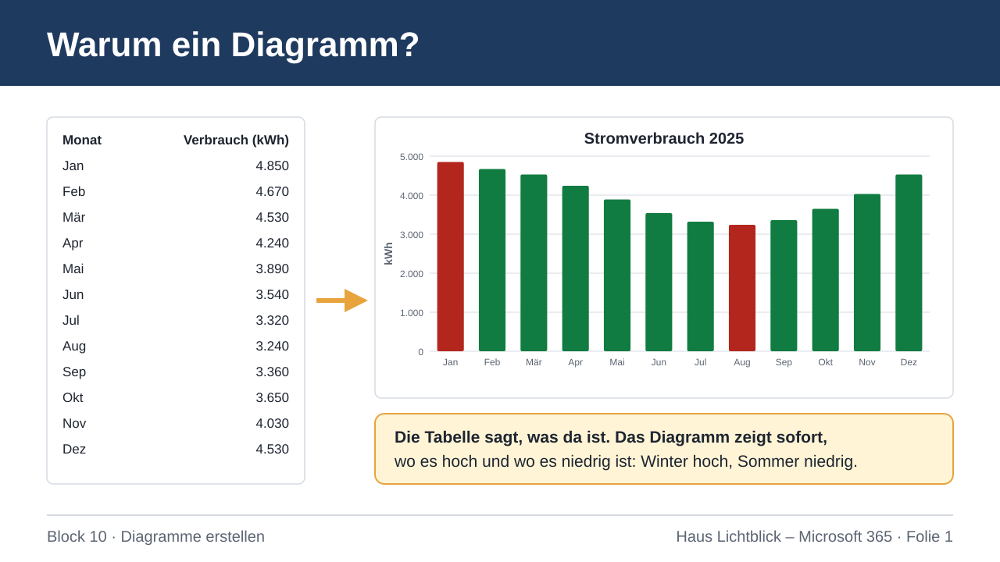
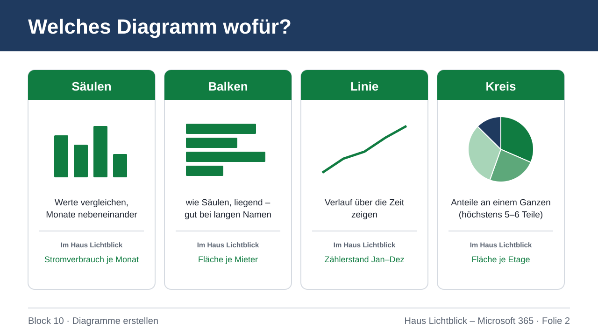
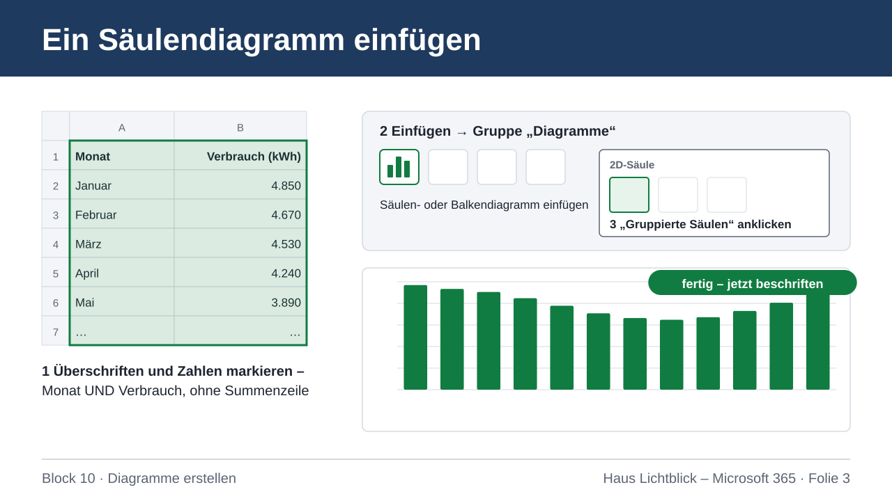
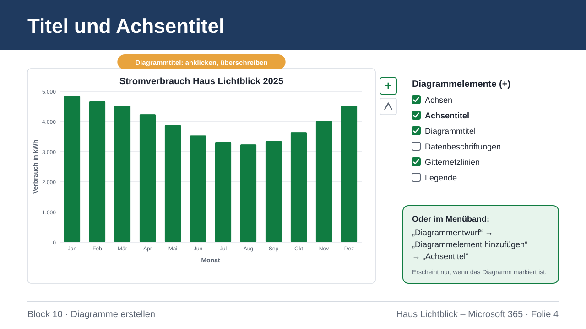
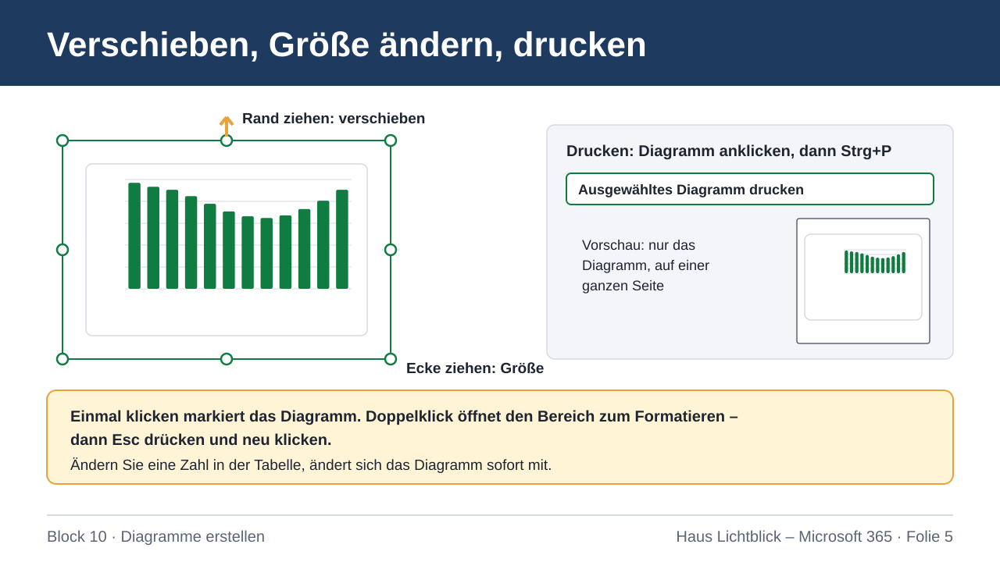

# Block 10 – Diagramme erstellen
{: .no_toc }

| | |
|---|---|
| **Programme** | Excel |
| **Voraussetzung** | Block 09 |
| **Übungsblatt** | [Übungsblatt Block 10](Block-10-Uebungsblatt.md) |
| **Übungsdateien** | `Block-10-Diagramme.xlsx`, Lösung `Block-10-Loesung-Diagramme.xlsx` – siehe [unten](#uebungsdateien) |

Zwölf Zahlen in einer Tabelle muss man lesen. Ein Diagramm sieht man: Im Winter verbraucht das Haus Lichtblick mehr Strom als im Sommer. In diesem Block machen Sie aus dem Stromverbrauch 2025 ein Säulendiagramm, beschriften es so, dass die Hausverwaltung es ohne Erklärung versteht, und drucken es aus.

{: .lernziele }
> - Erklären, wann ein Diagramm sinnvoll ist und welcher Typ wozu passt
> - Daten markieren und daraus ein Säulendiagramm einfügen
> - Diagrammtitel und Achsentitel hinzufügen
> - Ein Diagramm verschieben, vergrößern und gestalten
> - Ein Diagramm allein drucken

Inhalt dieser Seite

- TOC
{:toc}

## Warum ein Diagramm?

Eine Tabelle ist wie eine Liste im Lagerraum: Sie wissen, was da ist. Ein Diagramm ist wie ein beschriftetes Regal: Sie sehen sofort, wo viel und wo wenig steht. Diagramme lohnen sich, wenn

- **viele Werte verglichen** werden – zwölf Monate, acht Mieter,
- ein **Verlauf** sichtbar werden soll – steigt oder fällt der Verbrauch?
- **Anteile** gezeigt werden sollen – wie verteilt sich die Fläche auf die Etagen?

## Welches Diagramm wofür?

| Typ | Wann? | Im Haus Lichtblick |
|---|---|---|
| **Säulen** | Werte nebeneinander vergleichen | Stromverbrauch je Monat |
| **Balken** | wie Säulen, liegend – gut bei langen Namen | Fläche je Mieter |
| **Linie** | Verlauf über die Zeit | Zählerstand Januar bis Dezember |
| **Kreis** | Anteile an einem Ganzen, höchstens fünf, sechs Teile | Fläche je Etage |

{: .tipp }
Unsicher? **„Einfügen“** → **„Empfohlene Diagramme“**. Excel schlägt passende Typen für Ihre Daten vor und zeigt eine Vorschau.

## Ein Säulendiagramm einfügen

1. **Markieren** Sie die Daten mit den Überschriften: im Beispiel die Spalten „Monat“ und „Verbrauch (kWh)“ von der Überschrift bis Dezember. Die Summenzeile gehört **nicht** dazu.
2. Registerkarte **„Einfügen“** → in der Gruppe **„Diagramme“** auf **„Säulen- oder Balkendiagramm einfügen“** klicken.
3. Unter „2D-Säule“ **„Gruppierte Säulen“** wählen. Das Diagramm erscheint mitten auf dem Blatt.

{: .achtung }
Markieren Sie die Summe mit, bekommt sie eine eigene, riesige Säule – und alle Monate sehen winzig aus. Nur die Werte markieren, die verglichen werden sollen.

## Titel und Achsentitel

Ein gutes Diagramm erklärt sich selbst: **Was** wird gezeigt, **in welcher Einheit**, **wann**?

**Diagrammtitel:** Klicken Sie auf den Text „Diagrammtitel“ (oder den vorhandenen Titel), markieren Sie ihn und tippen Sie den neuen Titel, zum Beispiel „Stromverbrauch Haus Lichtblick 2025“.

**Achsentitel**

1. Klicken Sie einmal auf das Diagramm. Rechts daneben erscheint ein **+** („Diagrammelemente“).
2. Klicken Sie auf das **+** und setzen Sie das Häkchen bei **„Achsentitel“**.
3. Klicken Sie auf den Platzhalter „Achsentitel“ an der senkrechten Achse und tippen Sie „Verbrauch in kWh“, an der waagerechten „Monat“.

Den gleichen Weg gibt es im Menüband: Registerkarte **„Diagrammentwurf“** → **„Diagrammelement hinzufügen“** → **„Achsentitel“**.

{: .merke }
Die Registerkarten **„Diagrammentwurf“** und **„Format“** erscheinen nur, wenn das Diagramm markiert ist. Fehlen sie, klicken Sie einmal auf das Diagramm.

**Aussehen ändern:** Auf der Registerkarte „Diagrammentwurf“ finden Sie fertige **Diagrammformatvorlagen** und unter **„Farben ändern“** andere Farbsätze. Ein Klick genügt.

## Verschieben, Größe ändern, drucken

- **Verschieben:** Klicken Sie auf den Rand des Diagramms (nicht auf einen Balken) und ziehen Sie es an die gewünschte Stelle, zum Beispiel neben die Tabelle.
- **Größe ändern:** Ziehen Sie an einem der runden Anfasser in den Ecken.
- **Drucken:** Klicken Sie das Diagramm an und drücken Sie **Strg+P**. Unter „Einstellungen“ steht dann **„Ausgewähltes Diagramm drucken“** – die Vorschau zeigt nur das Diagramm, groß auf einer Seite.

{: .tipp }
Das Diagramm ist mit der Tabelle verbunden. Ändern Sie eine Zahl, wächst oder schrumpft die Säule sofort mit.

{: .praxis }
Für den Jahresbericht an die Hausverwaltung drucken Sie das Diagramm allein aus – oder Sie übernehmen es in einen Word-Bericht. Wie das geht, zeigt Block 11.

## Jetzt üben

{: .uebung }
> Laden Sie das [Übungsblatt Block 10](Block-10-Uebungsblatt.md) und die Übungsdatei herunter. Sie erstellen ein beschriftetes Säulendiagramm zum Stromverbrauch 2025 und ein Kreisdiagramm zur vermieteten Fläche je Etage.

### Übungsdateien
{: #uebungsdateien }



## Häufige Fragen

**Welche Zellen muss ich markieren?**
Die Spalte mit den Beschriftungen (Monate) **und** die Spalte mit den Zahlen, jeweils mit Überschrift. Keine Summenzeile.

**Kann ich den Diagrammtyp nachträglich ändern?**
Ja: Diagramm anklicken, „Diagrammentwurf“ → **„Diagrammtyp ändern“**.

**Brauche ich eine Legende?**
Bei nur einer Datenreihe nicht – der Titel sagt alles. Bei mehreren Reihen (zum Beispiel Strom 2024 und 2025) schon.

## Wenn es hakt

| Problem | Lösung |
|---|---|
| Das Diagramm zeigt falsche oder zu viele Daten. | Rechtsklick auf das Diagramm → **„Daten auswählen“** → Bereich korrigieren. Oder löschen (anklicken, Entf) und neu markieren. |
| Eine riesige Säule am Ende. | Die Summenzeile wurde mitmarkiert. Diagramm löschen, ohne Summe neu einfügen. |
| Die Registerkarte „Diagrammentwurf“ fehlt. | Das Diagramm ist nicht markiert. Einmal auf den Rand klicken. |
| Rechts geht ein Bereich „Diagrammbereich formatieren“ auf. | Das war ein Doppelklick. Bereich mit dem X schließen, beim nächsten Mal einfach klicken. |
| Beim Drucken kommt die ganze Tabelle. | Vor Strg+P das Diagramm anklicken. |
| Das Diagramm lässt sich nicht verschieben, nur ein Balken bewegt sich. | Esc drücken und am Rand des Diagramms anfassen, nicht an einer Säule. |

## Selbstcheck

Können Sie …

- [ ] sagen, wann Säulen, Linie oder Kreis passen?
- [ ] die richtigen Daten markieren und ein Säulendiagramm einfügen?
- [ ] Diagrammtitel und Achsentitel eintragen?
- [ ] das Diagramm neben die Tabelle schieben und vergrößern?
- [ ] nur das Diagramm drucken?

Wo Sie unsicher sind: den Abschnitt oben noch einmal lesen und die passende Aufgabe im Übungsblatt wiederholen.

## Für Coaching

{: .coaching }
> **Vorbereitung:** Excel geöffnet, die Übungsdatei liegt im Ordner Downloads. Zoom so einstellen, dass Tabelle und Diagramm zugleich zu sehen sind.
>
> **Tempo:** Das Markieren ist die häufigste Fehlerquelle. Beim Teilen des Bildschirms die Markierung vergrößern und laut sagen, von wo bis wo markiert wird.
>
> **Bildschirm teilen:** Den Unterschied zwischen Klick (Diagramm markiert, Registerkarten erscheinen) und Doppelklick (Formatierungsbereich geht auf) einmal bewusst zeigen.
>
> **Erfolg sichtbar machen:** Den Januarwert in der Tabelle ändern und zusehen, wie die Säule mitwächst. Danach Strg+Z.
>
> **Wer schneller ist:** eine Diagrammformatvorlage wählen; Datenbeschriftungen über das + einschalten; das Kreisdiagramm zur Fläche je Etage mit Prozentwerten versehen.

## Weiter

In [Block 11 – Programme verknüpfen](Block-11.md) bringen Sie Tabelle und Diagramm in einen Word-Bericht und schicken ihn mit Outlook an die Hausverwaltung.
