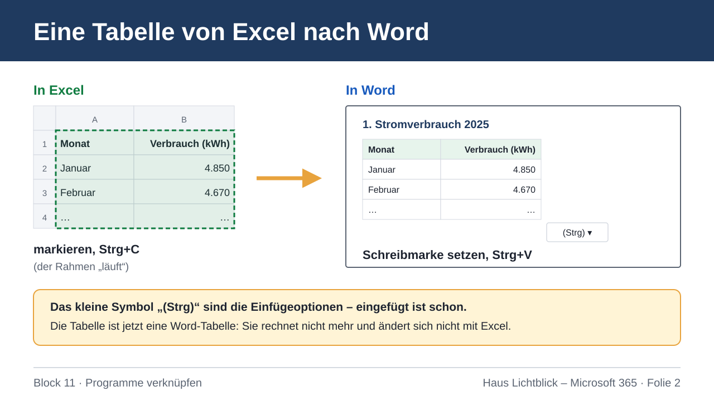
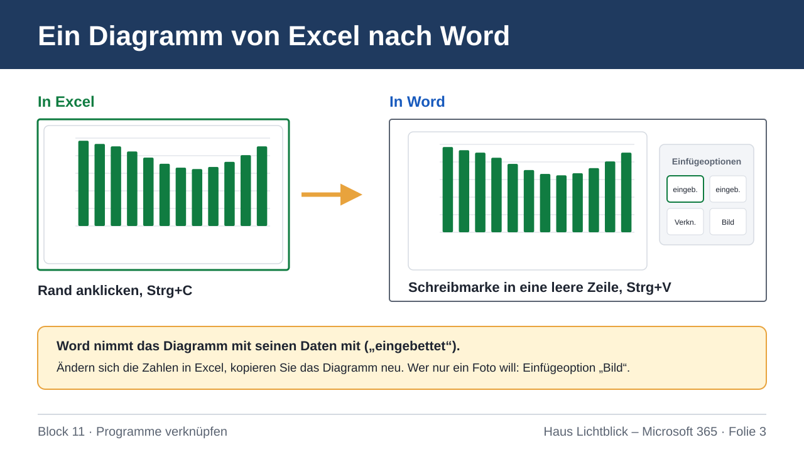
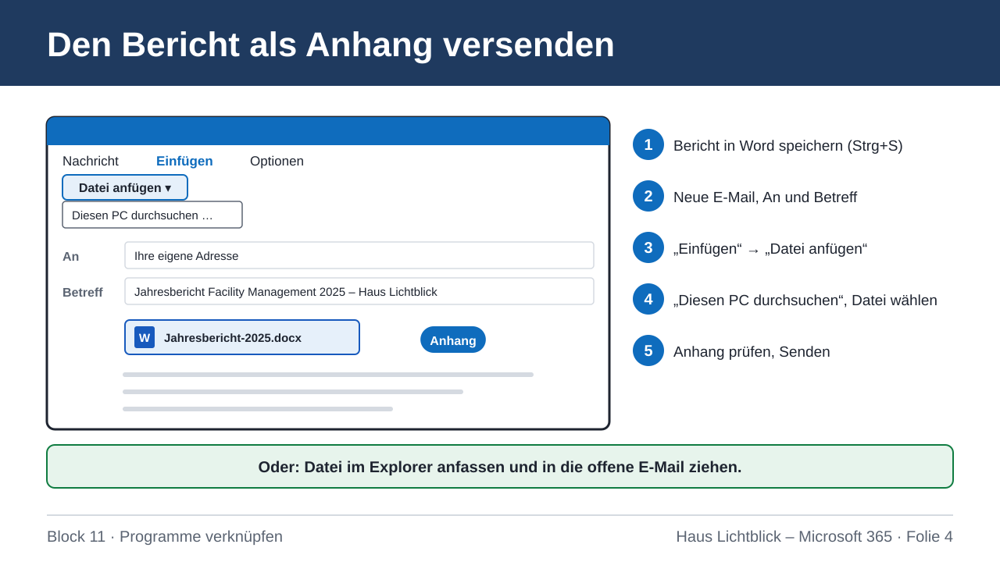
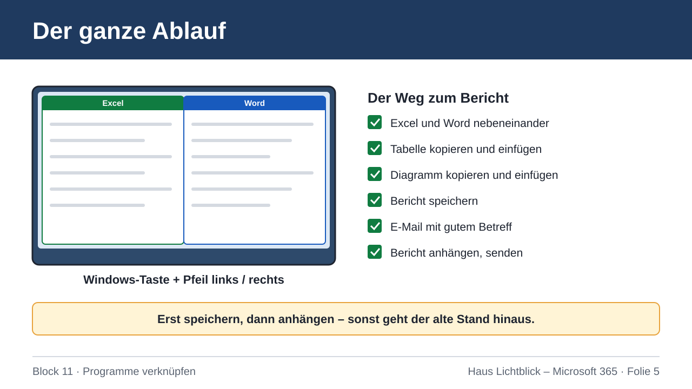

# Block 11 – Programme verknüpfen
{: .no_toc }

| | |
|---|---|
| **Programme** | Excel, Word, Outlook |
| **Voraussetzung** | Block 02, 05 und 10 |
| **Übungsblatt** | [Übungsblatt Block 11](Block-11-Uebungsblatt.md) |
| **Übungsdateien** | `Block-11-Strom.xlsx`, `Block-11-Bericht.docx`, Lösung `Block-11-Loesung-Bericht.docx` – siehe [unten](#uebungsdateien) |

Im Alltag arbeiten die drei Programme zusammen: In Excel liegen die Zahlen, in Word entsteht der Bericht, mit Outlook geht er an die Hausverwaltung. In diesem Block bringen Sie Tabelle und Diagramm zum Stromverbrauch aus Excel in den Jahresbericht 2025 und schicken ihn als Anhang per E-Mail.

{: .lernziele }
> - Den Ablauf „Daten → Bericht → Versand“ beschreiben
> - Eine Tabelle aus Excel kopieren und in Word einfügen
> - Ein Diagramm aus Excel in Word einfügen und die Größe anpassen
> - Einen Word-Bericht als Anhang mit Outlook versenden
> - Erklären, warum die eingefügte Tabelle eine Kopie ist

Inhalt dieser Seite

- TOC
{:toc}

## Drei Programme als Team

| Programm | Rolle | Im Haus Lichtblick |
|---|---|---|
| **Excel** | der Rechner | Stromverbrauch 2025 mit Diagramm |
| **Word** | der Schreibtisch | Jahresbericht für die Hausverwaltung |
| **Outlook** | der Briefkasten | E-Mail mit dem Bericht als Anhang an Petra Schönfeld |

{: .tipp }
Ordnen Sie Excel und Word **nebeneinander** an, dann sehen Sie Quelle und Ziel zugleich: In Excel klicken, **Windows-Taste+Pfeil links** drücken; Windows zeigt die übrigen Fenster – auf Word klicken, es füllt die rechte Hälfte (Block 01).

## Eine Tabelle von Excel nach Word

1. Markieren Sie in Excel die Zellen **mit den Überschriften**, zum Beispiel A3 bis B16.
2. Drücken Sie **Strg+C**. Um die Zellen läuft ein gestrichelter Rahmen.
3. Wechseln Sie zu Word und klicken Sie an die Stelle, an der die Tabelle stehen soll.
4. Drücken Sie **Strg+V**. Die Tabelle erscheint.

Unter der eingefügten Tabelle erscheint ein kleines Symbol **„(Strg)“** – die **Einfügeoptionen**. Sie müssen es nicht anklicken; eingefügt ist schon. Wer möchte, wählt dort zum Beispiel „Ursprüngliche Formatierung beibehalten“ oder „Nur den Text übernehmen“.

{: .merke }
In Word ist die Tabelle eine **Word-Tabelle**: Sie rechnet nicht mehr, und sie ändert sich nicht, wenn Sie in Excel eine Zahl ändern. Sie ist eine Kopie – wie ein Ausdruck.

## Ein Diagramm von Excel nach Word

1. Klicken Sie in Excel einmal auf den **Rand** des Diagramms – nicht auf eine Säule.
2. Drücken Sie **Strg+C**.
3. Klicken Sie in Word in eine leere Zeile und drücken Sie **Strg+V**.
4. Ist das Diagramm zu groß, klicken Sie es an und ziehen Sie an einer **Ecke**.

Word nimmt das Diagramm **mit seinen Daten** mit („eingebettet“). Es bleibt ein echtes Diagramm, aber es ist nicht mehr mit der Excel-Datei verbunden. Ändern sich die Zahlen in Excel, kopieren Sie es neu.

{: .tipp }
Soll das Diagramm nur ein festes Bild sein, wählen Sie in den Einfügeoptionen **„Bild“**. Ein Bild lässt sich nicht mehr bearbeiten, ist aber kleiner und sieht auf jedem PC gleich aus.

{: .merke }
Wie Sie Tabellen und Diagramme so **verknüpfen**, dass Word sich mit Excel ändert, zeigt das Aufbaumodul „Verknüpfung“.

## Den Bericht als Anhang versenden

1. Speichern Sie den Bericht in Word mit **Strg+S**.
2. Wechseln Sie zu Outlook und klicken Sie auf **„Neue E-Mail“**. Füllen Sie An und Betreff aus (Block 02).
3. Registerkarte **„Einfügen“** → **„Datei anfügen“** → **„Diesen PC durchsuchen“**.
4. Wählen Sie die Datei aus, zum Beispiel `Dokumente\Haus-Lichtblick\Jahresbericht-2025`, und klicken Sie auf **„Öffnen“**.
5. Der Anhang erscheint unter dem Betreff. Prüfen Sie den Namen und klicken Sie auf **„Senden“**.

{: .tipp }
Schneller: Ziehen Sie die Datei aus dem Explorer mit der Maus in die geöffnete E-Mail.

{: .achtung }
**Erst speichern, dann anhängen.** Outlook nimmt die Datei so mit, wie sie gerade gespeichert ist. Was Sie danach in Word ändern, ist nicht im Anhang.

{: .merke }
Liegt ein Bericht in **OneDrive**, können Sie statt einer Kopie einen **Link** schicken: In Word oben rechts **„Freigeben“**. Dann arbeiten alle mit derselben Datei. Empfänger außerhalb der eigenen Firma haben aber oft keinen Zugriff – der Anhang funktioniert immer.

## Der ganze Ablauf

1. Excel und Word nebeneinander anordnen.
2. Tabelle kopieren und in Word einfügen.
3. Diagramm kopieren und in Word einfügen.
4. Text ergänzen, Bericht speichern.
5. E-Mail mit gutem Betreff, Bericht anhängen, senden.

{: .praxis }
So entsteht im Haus Lichtblick jeder Bericht an die Hausverwaltung: der Jahresbericht, das Wartungsprotokoll mit der Liste der Störungen, die Bestellung für das Lager.

## Jetzt üben

{: .uebung }
> Laden Sie das [Übungsblatt Block 11](Block-11-Uebungsblatt.md) und die Übungsdateien herunter. Sie bauen Stromtabelle und Diagramm in den Jahresbericht 2025 ein, füllen die fehlenden Angaben und schicken den Bericht als Anhang an Ihre eigene Adresse.

### Übungsdateien
{: #uebungsdateien }



## Häufige Fragen

**Warum ändert sich die Tabelle in Word nicht, wenn ich Excel ändere?**
Beim normalen Einfügen nimmt Word eine Kopie. Für eine Verbindung gibt es eigene Einfügeoptionen – Thema im Aufbaumodul „Verknüpfung“.

**Kann ich auch die Excel-Datei selbst anhängen?**
Ja, genauso: „Datei anfügen“ und die Excel-Datei wählen. Die Hausverwaltung bekommt dann die Zahlen zum Weiterrechnen.

**Wie groß darf ein Anhang sein?**
Das hängt vom Postfach ab; Berichte mit ein, zwei Diagrammen sind unproblematisch. Sehr große Dateien besser über OneDrive als Link schicken.

## Wenn es hakt

| Problem | Lösung |
|---|---|
| In Word erscheint nur Text statt einer Tabelle. | In Excel die Zellen vollständig markieren, mit Überschriften, erneut Strg+C. |
| Das Diagramm ist riesig. | Anklicken und an einer Ecke kleiner ziehen. |
| Nach dem Kopieren passiert beim Einfügen nichts. | In Excel ist der gestrichelte Rahmen verschwunden (Esc oder Eingabe gedrückt). Noch einmal markieren und Strg+C. |
| Outlook findet die Datei nicht. | Im Fenster links auf „Dokumente“ klicken, dann den Ordner „Haus-Lichtblick“ öffnen. |
| Im Anhang fehlt die letzte Änderung. | Der Bericht war nicht gespeichert. Speichern, Anhang entfernen (X am Anhang), neu anhängen. |
| Die Fenster überlagern sich. | Windows-Taste+Pfeil links bzw. rechts. |

## Selbstcheck

Können Sie …

- [ ] Excel und Word nebeneinander anordnen?
- [ ] eine Tabelle aus Excel in Word einfügen?
- [ ] ein Diagramm aus Excel in Word einfügen und verkleinern?
- [ ] einen Bericht speichern und als Anhang verschicken?
- [ ] erklären, warum die Tabelle in Word sich nicht mit Excel ändert?

Wo Sie unsicher sind: den Abschnitt oben noch einmal lesen und die passende Aufgabe im Übungsblatt wiederholen.

## Für Coaching

{: .coaching }
> **Vorbereitung:** Excel, Word und das neue Outlook sind angemeldet. Klären, welche eigene Adresse für den Versand genutzt wird. Die Übungsdateien liegen im Ordner Downloads.
>
> **Tempo:** Nach Strg+C sofort zu Word wechseln, ohne in Excel noch irgendwo zu klicken – sonst ist die Kopie weg. Das Symbol „(Strg)“ nach dem Einfügen irritiert; sagen, dass man es ignorieren kann.
>
> **Bildschirm teilen:** Fenster nebeneinander. Den Weg im Dialog „Datei anfügen“ langsam zeigen: links „Dokumente“, dann den Ordner.
>
> **Erfolg sichtbar machen:** Den Anhang im eigenen Posteingang öffnen – der Bericht ist angekommen. Das ist der ganze Arbeitsablauf aus dem Kurs in einem Durchgang.
>
> **Wer schneller ist:** das Diagramm als „Bild“ einfügen und mit dem eingebetteten vergleichen; zusätzlich die Excel-Datei anhängen.

## Weiter

[Block 12 – Abschluss und Ausblick](Block-12.md) fasst den Kurs zusammen und gibt einen Ausblick auf Copilot.
