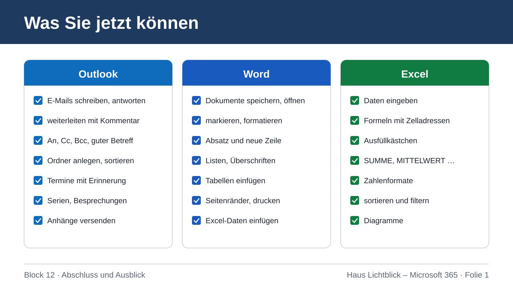
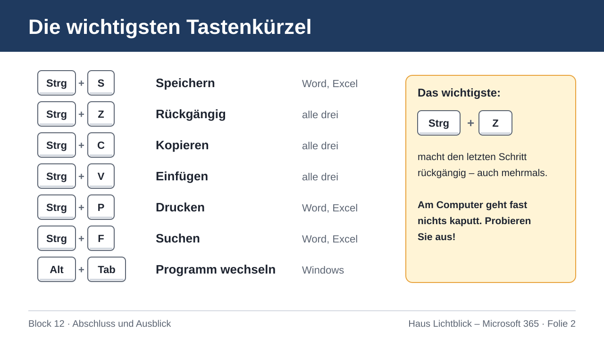
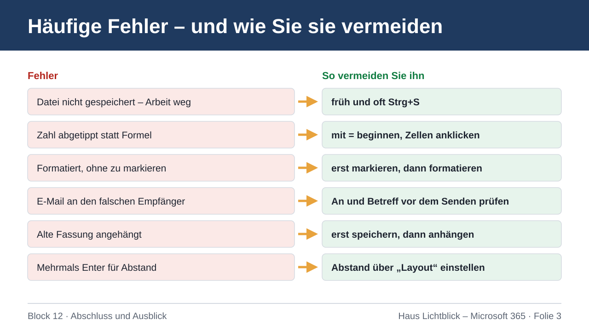
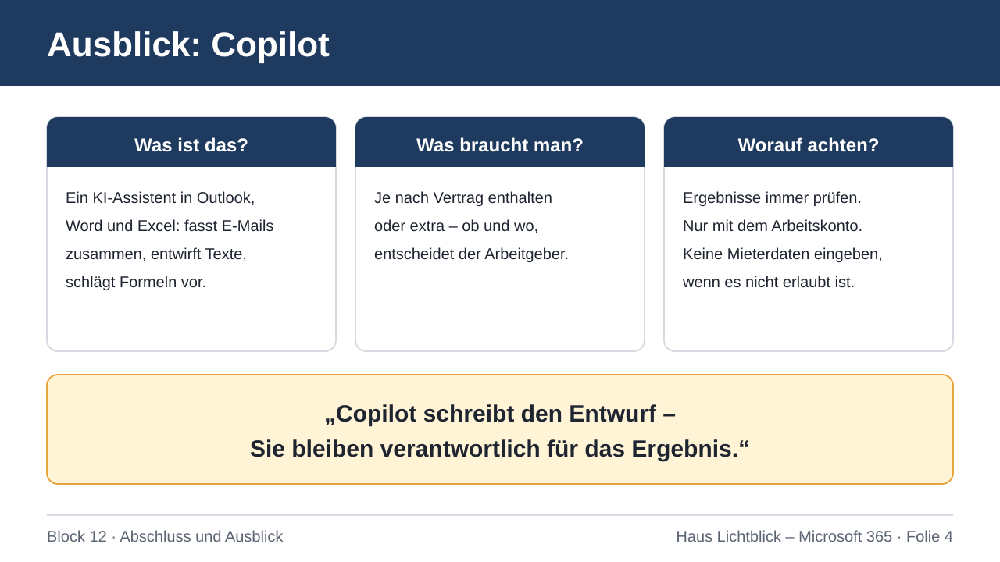
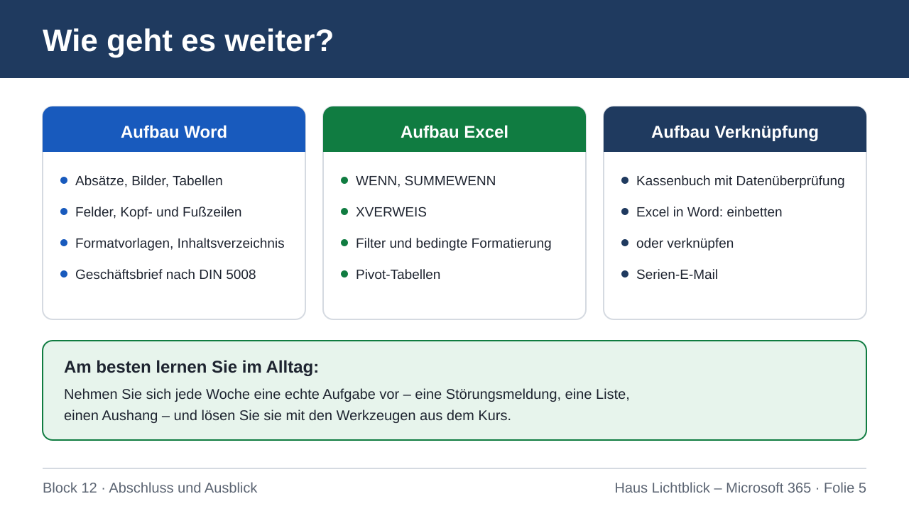

# Block 12 – Abschluss und Ausblick
{: .no_toc }

| | |
|---|---|
| **Programme** | Outlook, Word, Excel |
| **Voraussetzung** | Block 01 bis 11 |
| **Übungsblatt** | [Übungsblatt Block 12](Block-12-Uebungsblatt.md) |
| **Übungsdateien** | `Block-12-Kurzreferenz.docx` – siehe [unten](#uebungsdateien) |

Geschafft: Sie haben Outlook, Word und Excel kennengelernt und alle drei miteinander verbunden. In diesem letzten Block schauen Sie zurück, was Sie jetzt können, sammeln die wichtigsten Tastenkürzel und typischen Fehler und werfen einen Blick nach vorn – auf Copilot und die Aufbaumodule. Neuer Stoff kommt nicht dazu.

{: .lernziele }
> - Einschätzen, welche Aufgaben im Haus Lichtblick Sie jetzt selbstständig erledigen können
> - Die wichtigsten Tastenkürzel für Outlook, Word und Excel nennen
> - Häufige Fehler beschreiben und sagen, wie Sie sie vermeiden
> - Erklären, was Copilot ist und worauf Sie dabei achten
> - Ihren nächsten Lernschritt wählen

Inhalt dieser Seite

- TOC
{:toc}

## Was Sie jetzt können

| Programm | Das können Sie | Block |
|---|---|---|
| **Outlook** | E-Mails schreiben, beantworten und mit Kommentar weiterleiten; An, Cc, Bcc und einen guten Betreff wählen; Ordner anlegen | 02 |
| | Termine mit Erinnerung, Serien und Besprechungen anlegen | 03 |
| | Dateien als Anhang versenden | 11 |
| **Word** | Dokumente anlegen, speichern und wieder öffnen; Text markieren und formatieren; Absatz und neue Zeile unterscheiden | 04 |
| | Listen, Überschriften und Tabellen; Seitenränder und Druckvorschau | 05 |
| | Tabellen und Diagramme aus Excel einfügen | 11 |
| **Excel** | Daten eingeben, Spalten anpassen, erste Formeln mit Zelladressen | 08 |
| | Formeln ausfüllen; SUMME, MITTELWERT, MIN, MAX, ANZAHL; Zahlenformate; sortieren und filtern | 09 |
| | Säulen- und Kreisdiagramme | 10 |

{: .praxis }
Denken Sie an Ihren ersten Block zurück: Damals ging es darum, drei Programme zu öffnen und Fenster nebeneinander zu ordnen. Heute schreiben Sie einen Jahresbericht mit Tabelle und Diagramm und schicken ihn an die Hausverwaltung.

## Die wichtigsten Tastenkürzel

| Kürzel | Wirkung | Wo |
|---|---|---|
| **Strg+S** | Speichern | Word, Excel |
| **Strg+Z** | Rückgängig – auch mehrmals | alle drei |
| **Strg+Y** | Wiederherstellen | Word, Excel |
| **Strg+C** / **Strg+V** | Kopieren / Einfügen | alle drei |
| **Strg+P** | Drucken mit Vorschau | Word, Excel |
| **Strg+F** | Suchen | Word, Excel |
| **Strg+Umschalt+F** | Fett | Word, Excel |
| **Alt+Tab** | zwischen Programmen wechseln | Windows |

Alle Kürzel, Menüwege und Excel-Funktionen aus dem Kurs stehen in der **Kurzreferenz** zum Ausdrucken (Übungsdatei unten).

## Häufige Fehler – und wie Sie sie vermeiden

| Fehler | So vermeiden Sie ihn |
|---|---|
| Datei nicht gespeichert – Arbeit weg | Früh und oft **Strg+S** |
| Zahl abgetippt statt Formel – rechnet nicht neu | Mit **=** beginnen und Zellen anklicken |
| Formatiert, ohne zu markieren | Erst markieren, dann formatieren |
| E-Mail an den falschen Empfänger | An und Betreff vor dem Senden prüfen |
| Alte Fassung angehängt | Erst speichern, dann anhängen |
| Mehrmals Enter für Abstand | Abstand über „Layout“ → „Abstand“ einstellen |
| Liste sortiert, Zeilen passen nicht mehr | Nur eine Zelle anklicken, nicht die Spalte markieren; sonst sofort Strg+Z |

## Ausblick: Copilot

**Copilot** ist ein KI-Assistent in Microsoft 365. In Outlook fasst er lange E-Mails zusammen und entwirft Antworten, in Word schreibt er Textentwürfe, in Excel schlägt er Formeln vor und erklärt Tabellen.

- **Was brauchen Sie?** Je nach Vertrag ist Copilot enthalten oder kostet extra. Ob und in welchen Programmen Sie ihn nutzen können, entscheidet Ihr Arbeitgeber.
- **Worauf achten Sie?** Prüfen Sie jedes Ergebnis selbst – Copilot kann Fehler machen und Zahlen falsch übernehmen. Nutzen Sie ihn nur mit dem Arbeitskonto und geben Sie keine personenbezogenen Daten ein, etwa von Mietern, wenn der Arbeitgeber das nicht ausdrücklich erlaubt.

{: .merke }
Copilot schreibt den Entwurf – **Sie** bleiben verantwortlich für das Ergebnis. Was Sie im Kurs gelernt haben, brauchen Sie dafür weiter: Nur wer weiß, wie eine Formel aussieht, erkennt eine falsche.

Dieser Kurs übt Copilot bewusst nicht – dafür ist eine Lizenz nötig.

## Wie geht es weiter?

| Aufbaumodul | Themen |
|---|---|
| **Word** | Absätze, Bilder, Tabellen, Rechnen in Tabellen, Felder, Kopf- und Fußzeilen, Formatvorlagen und Inhaltsverzeichnis, Dokumentvorlagen, Geschäftsbrief nach DIN 5008 |
| **Excel** | WENN, SUMMEWENN, XVERWEIS, Text verbinden, Sortieren und Filtern mit dynamischen Arrays, bedingte Formatierung, Pivot-Tabellen |
| **Verknüpfung** | Kassenbuch mit Datenüberprüfung und Schutz, Excel-Tabellen in Word einbetten oder verknüpfen, Serien-E-Mail |

{: .tipp }
Am meisten lernen Sie im Alltag. Nehmen Sie sich jede Woche **eine echte Aufgabe** vor – eine Störungsmeldung, eine Liste, einen Aushang – und lösen Sie sie mit den Werkzeugen aus dem Kurs. Wo es hakt, schlagen Sie im passenden Block nach.

## Jetzt üben

{: .uebung }
> Das [Übungsblatt Block 12](Block-12-Uebungsblatt.md) enthält einen Selbsttest mit zwölf Fragen quer durch den Kurs, eine kleine Praxisaufgabe mit Outlook und Ihren persönlichen Plan für die nächsten Schritte. Die Kurzreferenz drucken Sie sich für den Arbeitsplatz aus.

### Übungsdateien
{: #uebungsdateien }



## Häufige Fragen

**Ich habe vieles schon wieder vergessen. Ist das normal?**
Ja. Was man nicht regelmäßig braucht, verblasst. Die Lerneinheiten bleiben online – schlagen Sie nach, wenn Sie etwas brauchen, und wiederholen Sie die Übungsblätter.

**Mit welchem Aufbaumodul soll ich anfangen?**
Mit dem Programm, das Sie im Alltag am meisten nutzen. Wer viele Listen führt, beginnt mit Excel; wer viele Briefe schreibt, mit Word.

**Brauche ich Copilot?**
Nein. Alles in diesem Kurs geht ohne. Copilot kann Arbeit abnehmen, ersetzt aber nicht das Verständnis.

## Selbstcheck

Können Sie …

- [ ] für jedes der drei Programme drei Dinge nennen, die Sie jetzt können?
- [ ] die Tastenkürzel für Speichern, Rückgängig, Kopieren, Einfügen und Drucken auswendig?
- [ ] drei typische Fehler nennen und sagen, wie Sie sie vermeiden?
- [ ] in einem Satz erklären, was Copilot ist und worauf Sie achten?
- [ ] sagen, welches Aufbaumodul Sie als Nächstes angehen?

## Für Coaching

{: .coaching }
> **Vorbereitung:** Kein neuer Stoff. Die Kurzreferenz ausdrucken oder gemeinsam herunterladen. Wenn möglich die Ergebnisse der Übungen (Aushang, Checkliste, Jahresbericht) bereitlegen.
>
> **Tempo:** Ruhig. Den Selbsttest gemeinsam durchgehen und bei jeder unsicheren Antwort den passenden Block aufschlagen.
>
> **Erfolg sichtbar machen:** Einsteigerinnen und Einsteiger unterschätzen ihren Fortschritt. Die eigenen Ergebnisse aus den Blöcken nebeneinanderlegen und ausdrücklich würdigen.
>
> **Copilot:** nur zeigen oder erzählen, nicht üben. Den Merksatz betonen.
>
> **Abschluss:** Gemeinsam den nächsten Schritt festlegen – ein Aufbaumodul oder eine konkrete Aufgabe aus dem Arbeitsalltag. Falls gewünscht, eine Teilnahmebestätigung ausstellen.

## Weiter

Der Grundkurs ist abgeschlossen. Zurück zur [Übersicht des Grundkurses](index.md) – oder weiter mit einem der Aufbaumodule.
